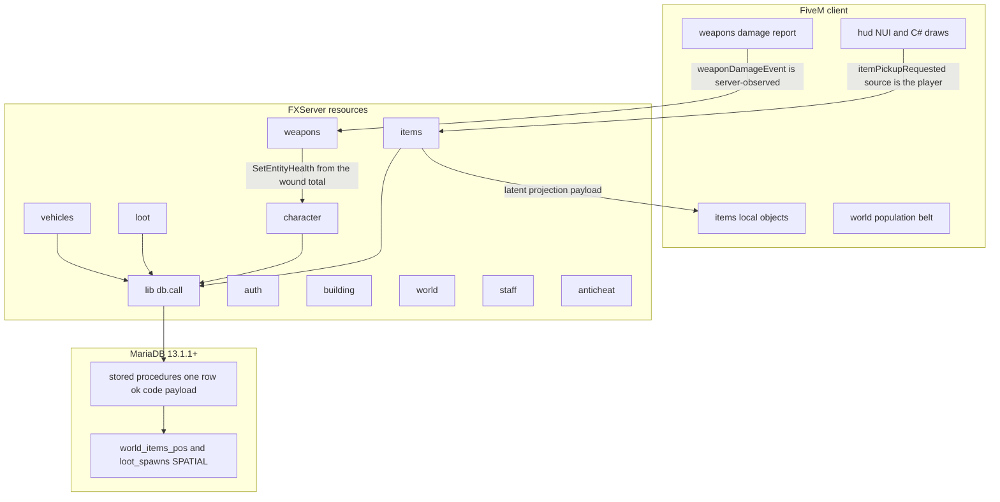
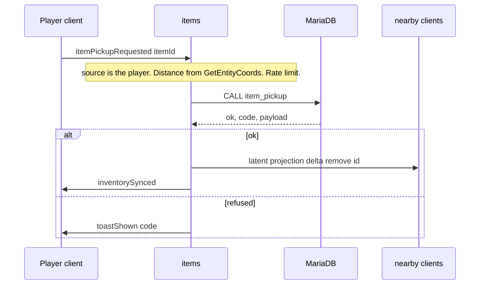

# Scavenge & Survive → FiveM (Los Santos)

| | |
|---|---|
| Author | VIRUXE |
| Date | 2026-11-06 |
| Status | Draft |
| Tracker | public `VIRUXE/scavengesurvive-v` |
| Behaviour baseline | finished MTA port `VIRUXE/scavengesurvive-mta` (not a fresh reading of the SA-MP Pawn) |
| Engine | FiveM **Legacy**, Mono C# on **.NET Framework 4.5.2**, OneSync, game build **3570** (`mp2025_01`, Money Fronts). Not Enhanced (.NET 10). |

This is an architecture and port plan. It does not contain gameplay code. A later step files GitHub issues from the port matrix in [Port matrix](#port-matrix). One matrix row is one issue.

## Overview

Scavenge & Survive is a PvP survival gamemode: physical items, a wound-and-bleed damage model, permadeath, a scarce loot economy, bases, and vehicles with fuel, locks, and trunks. The finished implementation of that behaviour is the MTA port (`resources/[scavengesurvive]/` under `scavengesurvive-mta`), backed by MariaDB stored procedures that return one row `ok, code, payload`. This document plans the same behaviour on FiveM, on the Los Santos map, in the public repository `VIRUXE/scavengesurvive-v`.

The world changes. Item names, sizes, recipes, loot weights, wound numbers, and the MariaDB item graph transfer. San Andreas coordinates, SA object ids, SA skins, hat DFFs, and the 11,066 SA loot points do not. Loot positions are authored on the GTA V map. Identity is the 2025 FiveM set (`license`, `license2`, `discord`, `fivem`, `steam`, `xbl`, `live`, `ip`, and tokens), which is what issues #1 and #3 already asked for, plus `license2`, `steam`, and tokens. UI is a NUI page plus C# draws. Damage stays server-authoritative. Population stays off. Appearance is freemode components and props.

Every gamemode resource is C#. `fxmanifest.lua` only names the built assemblies. There is no Lua gameplay, no `ox_lib`, and no Lua catalogue. User decision 2026-11-06.

Two earlier FiveM trees exist and are not the baseline. The 2023 repository is the tracker and a dead code layout. The 2025 spike proved identifiers, deferrals, and population switches. It is Lua, and nothing in it is imported.

## Background & Motivation

### The three trees

| Tree | Where | What it is | What this port uses it for |
|---|---|---|---|
| MTA port | `/gta/sa/mta/servers/scavengesurvive/scavengesurvive-mta`, public `VIRUXE/scavengesurvive-mta` | Finished gamemode. MariaDB schema in `sql/schema.sql` (2,685 lines, dumped live). 345 item types in `resources/[scavengesurvive]/data/generated/item_types.lua`. 11,066 loot rows in `sql/seed/0002_loot_spawns.sql`. 2,017 vehicle points in `sql/seed/0004_vehicle_spawns.sql`. Conventions in `CLAUDE.md`. | Behaviour, schema, procedures, event names, scarcity rules. Read only. Not modified by this plan. |
| 2023 FiveM repo | `VIRUXE/fivem-scavengesurvive`, archived 2026-11-06 after the useful parts moved here | Empty Lua stubs (`inventory`, `item`, `door`, `button`, `crafting`), stock CitizenFX resources, and an empty `popcycle.dat`. | Not used. The C# skeleton, the scenario list, the vehicle-name note, and issues #1, #3, #4, and #5 were copied. The GitHub repository is archived. |
| 2025 spike | `/gta/v/fivem/servers/scavengesurvive`. Remote recreated 2026-11-06 as private `https://github.com/VIRUXE/scavengesurvive-v`, tip `ac96399`. Still Lua. 40 first-party `*.lua`/`*.js` files, **3,726** lines, excluding `ox_lib`, `oxmysql`, `vMenu`, `node_modules`, and `[maps]` (`wc -l`). | oxmysql 2.13.1, ox_lib, a deferral login, `schema.sql` with email accounts, commented-out population suppression, vMenu, third-party ymaps. | Behaviours to reimplement in C#, and behaviours to leave. No file is imported. See [2025 spike: keep and drop](#2025-spike-keep-and-drop). |

`VIRUXE/fivem` is a stale citizen fork (0 ahead, 115 behind) and is not the tracker. Engine facts below come from public docs at `https://docs.fivem.net` and from the vendored oxmysql 2.13.1 manifest in the spike. No leaked GTA V source was read.

### Why the MTA classification table is not copied

The preliminary table in `docs/superpowers/specs/2026-09-27-scavengesurvive-mta-port-design.md` was written before the port finished. Where it disagrees with the issue tracker or a later ADR, the later record wins:

| Topic | Stale spec table | Later record used here |
|---|---|---|
| Scarcity | Fixed 30-minute loot re-roll in the original design | ADR `docs/adr/0001-scarcity-respawn.md` (accepted 2026-10-23, implemented under #67) plus the 2026-11-03 correction: unspent whole-item allowance expires every refill tick. #67 is still open; that is a tracker miss, not an open design. |
| Travel stats | The early matrix and the open issue disagree | #138 is **open**, and the code is shipped. `character/server/main.lua` loads `shared/logic/travel.lua` and `server/travel.lua`. Kinds are `walking`, `running`, `sprinting`, `crouching`, `swimming`, `driving`, `air` (no separate underwater kind). Counters are session-only. Port those files. The open issue is a tracker miss, same class as #67. |
| Explosives | "Not in the finished loop" | #134's body says nothing is ported. That body is stale. `server-config/resources.xml` starts `explosives`. `explosives/server/main.lua` calls `explosion_damage`. `explosives/shared/logic/explosives.lua` holds the presets, EMP knockout of 60 s, and shrapnel. Port those files. The open issue is a tracker miss. |
| Recipes | Implied parity | #147's body is stale. `crafting/shared/logic/craft.lua` is the list: 4 hand combines, 13 ground builds, 28 workbench sets, and `getDeconstructInfo` returns every consumed ingredient. Commit `04f4174` (2026-10-30) replaced the early list with upstream's sets. Commit `606d836` (2026-11-01) records that pass as complete. The 29 names in the issue are in that file. What that commit actually removed, because they are not upstream sets: the Barricade craft (Hammer, 3 Wood Logs), the Small Box craft (Hammer, 2 Wood Logs), the Door craft (Screwdriver, Large Frame + Crate Door), and the Metal Gate craft (Wrench, Large Frame + Metal Frame). Barricade has no item left. Small Box, Metal Door, and Metal Gate stay as items (loot, safebox, defences). They are not crafted. `init.pwn` is not re-read. |
| Armour, wear-from-hand, handcuffs, liquid ammo | Covered by broad "port char/item" rows | #154, #155, #156, #158 are **open** and describe the gap. FiveM ports the behaviour those issues specify. |
| Hatless skins, SA model colour | Port / in progress (#99, #96) | No SA meshes on FiveM. #99 is `drop`. #96's tint is `replace` by distinct props. |
| Tow truck | Early row said port | Spec body and CLAUDE.md: no such vehicle type. `drop`. |
| Anticheat | "port all checks" in the early matrix | `docs/anticheat.md` Checks table is the record, not the dropped-set sentence in the early spec. Still running: teleport, frozen rollback, jetpack, swim-fly, vehicle health above 990, empty-vehicle teleport, hacker-trap veto, excess-accuracy warn, ping, focus loss, fields. Dropped there: money, nitro/hydraulics, camera distance, shooting-animation, invalid-hit. #100 is the live-check issue, not a licence to drop jetpack or swim-fly. |

### Pain on FiveM that MTA did not have

- GTA V applies its own weapon damage, headshot crits, and health regen. The wound model has to cancel that, not sit beside it.
- OneSync replicates server entities. The MTA world projection was already client-side because of the element cap (ADR 0011). The same rule is mandatory here: a world of thousands of items cannot be thousands of networked entities. Infinity's documented id extension is 8192 to 65535 (`https://docs.fivem.net/docs/scripting-reference/onesync/`), which is still the wrong shape for loose loot, and `citizenfx/fivem#2751` discusses that extension interacting with population. Day-1 spike, not an assumption.
- There is no MTA `bindKey`, no dx, no `createBuilding`, no `getPlayerSerial`, no `passwordHash`. Each has a FiveM replacement named below.
- The SA map's 11,066 loot coordinates and 2,017 vehicle points are in a different city. An affine transform is rejected in [Alternatives](#alternatives-considered).

## Goals & Non-Goals

### Goals

- Player experience of the MTA port, on Los Santos, for 100 players with headroom toward 200.
- Many resources, no prefix. MariaDB is the only shared state. One stored-procedure call is the atomic unit, not a Lua transaction.
- Port the essence. Recompute every area as `port`, `replace`, `drop`, or `defer` for FiveM.
- A port matrix a later step can file as roughly 120–160 issues. This document has **158** rows (F001–F158). Epics are not rows.
- Old issues #1, #3, #4, #5 stay open. The matrix says which epic each joins.

### Non-Goals

- Making `VIRUXE/scavengesurvive-v` public. Wiki, Pages, and secret scanning are unavailable and are not designed around. Issues, milestones, labels, and Actions are.
- A test suite. User decision on the MTA port, 2026-10-31: no tests are created. Live checks are named. No test-suite pull request.
- Re-deriving SA-MP Pawn behaviour. Citations are MTA issue numbers.
- Copying the 2025 worktree, the 2023 resources, SA coordinates, SA models, or leaked game source.
- Gameplay code in this pass.
- Multi-server sharding, a public website, or a legacy Whirlpool import.
- txAdmin or vMenu as the staff tool. txAdmin may supervise the process. Staff power is `accounts.admin_level`.

## Key Decisions

These are the approved constraints, recorded so a later issue does not reopen them.

1. **Behaviour source is the finished MTA port.** Where an MTA issue records a decision, cite `VIRUXE/scavengesurvive-mta#N`. Do not re-read the Pawn to invent a second behaviour. Open bugs whose bodies still match missing code (#154, #155, #156, #158) are ported as those issues describe the gap. #67, #134, #138, and #147 are open in the tracker and shipped in the tree. Port the code, and treat the issue body as a tracker miss. #147's recipe list is `crafting/shared/logic/craft.lua`, not the issue text.
2. **World is Los Santos, not San Andreas.** Names, sizes, recipes, loot weights, wound numbers, and the item graph transfer. Coordinates, object ids, skins, hat DFFs, and the 11,066 loot points do not. New points are authored on the GTA V map.
3. **The tracker is public** `VIRUXE/scavengesurvive-v` (moved 2026-11-06 off the 2023 repo, and made public the same day by the owner). That reverses the earlier "keep it private" rule. Issues, milestones, labels, and commits are the tracker. Docs stay in the repo. No wiki and no GitHub Pages. Secret scanning and push protection are on. The way of working is `docs/process.md`. The C# projects live in `resources/[scavengesurvive]/`. The resource name `world` is that C# project. The old Lua world folder is `spike-lua/world` and is not scanned. `player` and `vehicle` are spike Lua names and are not gamemode resources.
4. **Many resources, no prefix, MariaDB is the only shared state.** Domains: `lib`, `data`, `auth`, `character`, `items`, `crafting`, `apparel`, `weapons`, `vehicles`, `loot`, `building`, `world`, `hud`, `staff`. Infrastructure beside those: `logs`, `anticheat`, `dev`. No `maps` resource (the map is the game). No `ui` resource (`hud` owns the NUI page). No `explosives` resource: the shipped MTA `explosives` resource's behaviour lands in `world`. OneSync server entities. State bags for small replicated per-entity facts. Atomicity is one stored-procedure `CALL`, not a multi-statement transaction in C#.
5. **Every gamemode resource is C#** (user decision 2026-11-06). This overrides the earlier Lua 5.4 choice. Each resource is a solution in the shape of `VIRUXE/cfx-csharp-boilerplate`: a Client class library (`client.net.dll`), a Server class library (`server.net.dll`), and `Shared/**/*.cs` compiled into both. `fxmanifest.lua` stays because FiveM requires it, and it only declares the assemblies. The Mono runtime's target is **.NET Framework 4.5.2**. The boilerplate README says that framework is "at this time", the csproj sets `TargetFrameworkVersion` `v4.5.2`, and `CitizenFX.Core.Client` 1.0.7537 / `CitizenFX.Core.Server` 1.0.7538 resolve `lib/net45`. The current runtime page (`https://docs.fivem.net/docs/scripting-manual/runtimes/csharp/`) still describes that Mono workflow and says the template builds "the correct .NET Framework". It does not name a newer Mono TFM. FiveM for GTA V Enhanced replaces Mono with .NET 10; Enhanced is already out of scope (decision 16). The boilerplate TFM is not stale for Legacy. FXServer loads prebuilt DLLs (`client_script 'client.net.dll'`, and the first-script guide says the built DLL has to be in the resource folder). It does not run MSBuild. Both Debug and Release set `OutputPath` to the resource root (`..\`), the same place the manifest loads. The boilerplate's Release path `bin\Release\` is not used. Commit `client.net.dll` and `server.net.dll` beside `fxmanifest.lua` in every PR that changes a `.cs` file. Gitignore `bin/`, `obj/`, and NuGet `packages/`. Those directories are not the artifact.
6. **Auth is the FiveM identifier set**, not MTA serials: `license`, `license2`, `discord`, `fivem`, `steam`, `xbl`, `live`, `ip`, and tokens. bcrypt cost 10, `char(60)` hashes. No Whirlpool import. No email account (the spike's `accounts.email` is dropped).
7. **UI is NUI plus C# draws. `ox_lib` is not used.** It is Lua. Toasts, hold progress, and key hints are either the inventory NUI or a C# draw (`DrawRect` / text natives) so a fight does not keep a browser focused. The connecting Adaptive Card stays. HTML/JS/CSS for that one NUI page is a UI surface, not a gameplay resource. Not MTA dx, not SA-MP dialogs, not a CEF page per widget.
8. **Damage is server-authoritative.** Cancel native health loss and apply the MTA wound model as `applyWound` and `wound.lua` actually run it: numeric count, kill on HP, no 32-wound cap. Weapons and vehicles are GTA V hashes. Population stays off.
9. **Appearance is freemode** `mp_m_freemode_01` / `mp_f_freemode_01` components and props. No SA skins, no hatless DFF pipeline.
10. **The 2025 Lua in this repo is a spike.** Behaviours to reimplement in C#, and behaviours to leave, are named below. Do not treat that Lua as the port. The tracker is this repo. The C# projects are in `resources/[scavengesurvive]/`.
11. **Issues #1, #3, #4, #5 stay open** and are relabeled onto epics by the tracker step. See [Existing FiveM issues](#existing-fivem-issues).
12. **Port classes are recomputed.** Many MTA `port` rows become `replace` (native vehicles, weather, time, streaming) or `drop` (SA models, MapAndreas, textdraws, GPCI, `samp_models`). Wounds, the item graph, permadeath, crafting, defences, and the loot economy stay `port`.
13. **No leaked source.** Docs: `https://docs.fivem.net`. Public `citizenfx/fivem` is acceptable if cloned later. `VIRUXE/fivem` is not the reference.
14. **No tests in implementation.** Live checks only.
15. **Solo developer. 100 players, headroom toward 200.** OneSync above 48 slots needs a Cfx element-club subscription (`https://docs.fivem.net/docs/scripting-reference/onesync/`). That is an operations cost, not optional if the server actually runs at the design load.
16. **Game build 3570 on Legacy**, matching the spike's `sv_enforceGameBuild 3570` and the build table at `https://docs.fivem.net/docs/server-manual/server-commands/#sv_enforcegamebuild-build`. FiveM for GTA V Enhanced loads the latest build and does not honour older pins. Enhanced is out of scope until the pin is deliberately dropped.
17. **Loose items are not networked entities.** Client-local objects from a projection payload. Vehicles and built defences that must share collision are server entities with `SetEntityOrphanMode(..., 2)`.
18. **Native fuel consumption stays off** (`SET_FUEL_CONSUMPTION_STATE`). The MTA litre, petrol can, and station economy is the behaviour (`https://docs.fivem.net/docs/scripting-manual/using-new-game-features/fuel-consumption/` describes a different model: RPM × handling multiplier, ~65 L tank). The server stalls the engine when the row's `fuel` hits 0.
19. **License auto-resume replaces IP auto-login.** If a `license` is bound to exactly one account and `auth.license_autologin` is on (default on), the deferral resumes that account. A new license always requires the password. This is not MTA #86 (auto-login by IP), which is not ported.
20. **First authored district is south Los Santos.** Shipped zone ids, all ≤ 16 characters: `DAVIS`, `STRAWBERRY`, `CHAMBERLAIN`, `RANCHO`, `LAMESA`, `CYPRESS`, `BURRO`, `PORT`, `ELYSIAN`, `LSIA`. Strawberry and Chamberlain Hills are their own ids, not folded into a neighbour. Blaine County and the north are M8 content. The economy does not wait on 11,066 points.
21. **`zone` widens from `varchar(8)` to `varchar(16)` on every zone column**, not only `loot_spawns` and `world_budget`. That is also `items.loot_zone`, `supply_drop_points.zone`, and `weapon_cache_points.zone`, plus `item_create`'s `DECLARE v_zone VARCHAR(8)`. `GRAPESEED` is 9, `STRAWBERRY` is 10, `CHAMBERLAIN` is 11. SA zone codes (`LS`, `SF`, `BC`, …) are not reused.
22. **SQL goes through oxmysql. There is no `Db.Call`.** Owner decision 2026-11-06. The C# import is `lib/Server/MySql.cs`, the same job as `@oxmysql/lib/MySQL.lua`. Each server project compiles that file and calls `MySql.Query`, `Single`, `Scalar`, `Update`, `Insert`, `Prepare`, `Raw`, or `Transaction` with placeholders. No C# MySQL driver. No procedure wrapper. No `CALL` gate. The MTA procedures stay the behaviour to reimplement as statements. Spike S3 is cancelled. Where an older paragraph still says `Db.Call` is the only path, this decision wins.
23. **A finished slice updates the commit, the docs, and the issues together.** Owner rule 2026-11-06. Mandatory. `AGENTS.md` states it for every session. The steps are `docs/process.md`. A slice left with only code, or only a comment on a stale issue, is not done.
24. **A resource restarts alone, through qrcon. The FXServer process stays up.** Owner rule 2026-11-06. `qrcon 127.0.0.1:30120` runs `restart <resource>` for the one resource that changed. The password is `rcon_password` in gitignored `env.cfg`. Peers stay running. No `fxmanifest` `dependency` may stop or restart another resource. Start order stays the `ensure` lines. A convar read only at process start is not a reason to restart the process unless the owner asks.

## Proposed Design

### Essence (carried from the MTA spec, ADR 0008)

Non-negotiable, checked by play on the LS map, not by code equality with Pawn:

- PvP-only survival. No command gameplay. A handful of keys (F interact, N drop/give, Y put away, H inventory, R reload). Everything the player handles is a physical item.
- The item graph: held, holstered, 6-slot inventory, bags, containers, trunks, safeboxes, tents. Size-unit budget, dense slots. Invariants live in MariaDB (`chk_items_one_location`, unique holder kind, unique container slot).
- Wound and bleed. No direct HP as the rules. A numeric wound count, knockout, infection, hunger, drugs. Death is HP reaching 0 (`character/server/main.lua` `applyWound`), not a 33rd wound. `MAX_WOUNDS 32` is only in the MTA spec's Pawn appendix. `weapons/shared/logic/wound.lua` has no cap. Head knock multiplier 9.9. The count is memory: `survival.loadWounds` rebuilds 0 or 1 from persisted bleed, because `character_flush` does not write `characters.wounds`. Numbers stay the running MTA numbers.
- Loot economy: weighted tables, supply drops, weapon caches, and scarcity (ADR 0001, including the 2026-11-03 allowance expiry).
- Base building: defences, plot poles, keypads, motors, workbench, machines. Raid is explosives (#134), not the crowbar from outside.
- Vehicles with fuel, locks, and trunks.
- Permadeath: one alive character per account (`characters.alive_account`), everything drops on death, combat-log inside the window counts as death.
- Staff tiers 1–5 from `accounts.admin_level`, action log in `staff_actions`.
- Languages: two families, both ported. `lang_*.lua` is ten files including `lang_en.lua` (login text, item `*_T` tooltips, short codes). `strings_*.lua` is nine files (`es`, `fr`, `pt`, `ptbr`, `ru`, `ro`, `cs`, `id`, `bhs`): English sentence to translation. There is no `strings_en.lua`. English is the key. Do not regenerate `strings_*.lua` from `tools/convert` (`CLAUDE.md`). On FiveM both families are C# data compiled into `data`, not Lua tables.

Free to change: how sync, UI, streaming, identity, appearance, and props work. The nine upstream bugs the MTA fixed stay fixed (bandage infects the patient, not the healer; skills persist; and the rest listed in the MTA spec under ADR 0007). Intentional MTA deviations that are already accepted stay accepted: death-drop ring of nine (#91), locker facing (#143), machine output counts (#145), session-only travel counters (#138), hatless twins **not** reimplemented.

### Resources

All under `resources/[scavengesurvive]/<name>/` with no prefix. Each resource is its own solution, matching `VIRUXE/cfx-csharp-boilerplate`:

```
fx_version 'cerulean'
game 'gta5'

client_script 'client.net.dll'
server_script 'server.net.dll'
```

`hud` also declares `ui_page` and `files` for the one inventory NUI. No second `ui_page`. No `lua54`. No `shared_script` of Lua. Pure types that do not open a socket live in `Shared/**/*.cs` and are compiled into both assemblies (`<Compile Include="../Shared/**/*.cs" />`). No MySQL driver lives in any gamemode assembly. SQL is an oxmysql export call from the server script that needs it (decision 22). Client classes inherit `BaseScript`. Server classes inherit `ServerScript`, as the boilerplate's `Server/Main.cs` does. Both configurations set `<OutputPath>..\</OutputPath>` so `client.net.dll` and `server.net.dll` land next to `fxmanifest.lua`. Release does not write `bin\Release\`.

Cross-resource contract, same as MTA `CLAUDE.md`: pass numeric ids, never entity handles. The manifest docs show the call shape (`https://docs.fivem.net/docs/scripting-reference/resource-manifest/`, Consuming an export, C#):

```csharp
int widget = Exports["myresource"].getWidget();
```

A defining server script registers with `Exports.Add` (the same page says to prefer `Exports.Add` over a manifest `server_export` list). Example:

```csharp
Exports.Add("getHeld", new Func<int, object>(GetHeld));
```

Callers check `GetResourceState(name) == "started"` before the call. A stopped resource's export is not invoked. Export arguments are ids and plain values. Do not pass a `Ped` or `Vehicle` handle across a resource.

Event names are the MTA names already shipped: `<subject><PastTenseVerb>` camelCase, no `on`, `onClient`, or `Request` prefix. Examples from MTA `items/shared/events.lua` and `auth/shared/events.lua`: `itemCreated`, `itemPickupRequested`, `inventoryOpened`, `playerAuthenticated`, `loginRequested`. Direction is which API fires the event, not the name. There is no `shared/events.lua`. The C# method is the declaration.

- Server-local: `TriggerEvent("itemCreated", itemId)` (`https://docs.fivem.net/docs/scripting-manual/working-with-events/triggering-events/`).
- Client to server: `TriggerServerEvent`. The handler takes `[FromSource] Player source` (`https://docs.fivem.net/docs/scripting-manual/working-with-events/listening-for-events/`). That player is the only trusted identity. A character id in the payload is checked against the session `auth` stored for that player's server id.
- Server to client: `player.TriggerEvent(...)` for one player, or `TriggerClientEvent` for everyone. The triggering-events page notes that C# does not use a target of `-1`. Payloads over a few kilobytes (a projection cell) use `TriggerLatentClientEvent` with an explicit bps budget. State bags are not a bulk channel.
- Handlers: `[EventHandler("itemPickupRequested")]` or `EventHandlers["itemPickupRequested"] += ...`.

```csharp
[EventHandler("itemPickupRequested")]
private void OnPickup([FromSource] Player source, int itemId) { /* ids only */ }
```

Start order is `server.cfg` `ensure` lines, which is also dependency order. A resource restarts alone through qrcon (decision 24). Do not add an `fxmanifest` `dependency` that stops or restarts a peer. Peers stay up.

| Resource | Side | Owns | Key exports / events |
|---|---|---|---|
| `lib` | shared C# plus a server-only assembly | `Shared`: rate limit, one-shot token, log field shape, vectors. No socket. No MySQL driver. `Server/MySql.cs` is the oxmysql import, compiled into every server assembly. | `MySql.Query`, `Single`, `Scalar`, `Update`, `Insert`, `Prepare`, `Raw`, `Transaction`. |
| `data` | shared C# | Catalogues compiled in from the MTA generated files, as C# types or embedded resources. Item types (names, sizes, categories, calibres, recipes), loot tables, both language families, vehicle class rows. SA `model` and `baseWeapon` are not runtime fields. `Prop` and `WeaponHash` are `uint` joaats (`Weapon` stays the ported stats object). Both are 0 until a later row writes one. Unmapped `Prop` resolves through `PropHash` to `prop_box_wood05a` (joaat `2781083456`), not SA model `331` and not MTA model `1271`. `WeaponHash` 0 stays 0 until F081. | `GetItemType`, `GetLootTable`, `GetRecipe`, `Lang.ItemType`, `Lang.Text`, `Lang.TextFor`, `PropHash`. |
| `auth` | server + client NUI/card | Accounts, bcrypt, identifier and token binding, bans, whitelist, connection log, admin level, language. Deferral Adaptive Card during `playerConnecting`. | `getAccountId`, `getCharacterId` is **not** here, `getAdminLevel`. Emits `playerAuthenticated`, `playerLoggedOut`. Handles `loginRequested`, `registrationRequested`. |
| `character` | server + client | Character row, appearance JSON, survival tick (food, bleed, infection, drugs, knockout), skills, travel stats, spawn, death, save-block, combat-log clock. | `getCharacterId`, `isHandsUp`, `isKnockedOut`. Emits `characterSpawned`, `characterDied`, `characterStatsSynced`. |
| `items` | server + client | The item graph. World rows. Projection payloads. Pickup, drop, give, wear, containers, use dispatch. | `createItem`, `destroyItem`, `getHeld` by character id. Emits `itemCreated`, `itemMoved`, `itemDestroyed`, `itemUseAttempted`. Handles `itemPickupRequested` and the rest of the MTA client-to-server list. |
| `crafting` | server + client | Recipes, workbench, combine, deconstruct. Procedures `craft_combine`, `craft_workbench`, `craft_deconstruct`, `craft_ground`. | `craft`. |
| `apparel` | server + client | Applies freemode components and props from worn hat, mask, armour, bag. Body preview is a NUI render of those indices, not a second ped clone of an SA skin. | `applyAppearance(charId)`. |
| `weapons` | server + client | Hash map, ammo, the wound formula in `shared/logic` (ported from MTA `weapons/shared/logic/wound.lua`), damage cancellation, tracers, cuffs, disarm. | `applyDamage`. Emits `woundInflicted`. |
| `vehicles` | server + client | Rows, server-side create, fuel, locks, trunk container id, repair, trailers, scarcity refill. | `getVehicleId` by entity is internal; other resources pass the row id. State bag keys: `vehicleId`, `fuel`, `locked`. |
| `loot` | server | Authored spawn points, `loot_roll`, ADR 0001 budget, supply drops, caches. | `rollNear`. Emits `lootSpawned` (server-local) which `items` turns into a projection delta. |
| `building` | server + client | Defences, plot poles, keypads, motors, tweak. Server entities for placed defences. | `placeConstruction`. |
| `world` | server + client | Population belt, weather, clock, LS zone polygons, fuel outlets, explosives, radio. Trees deferred. | `getZoneAt`. Emits `playerZoneEntered`, `playerZoneLeft`. |
| `hud` | client + server C#, plus one NUI page | Inventory and body preview in HTML/JS/CSS. Status bars, key hints, and short toasts drawn in C#. `RegisterKeyMapping` for the five keys. No ox_lib. | Handles `inventoryOpened`, `toastShown`, `characterStatsSynced`. |
| `staff` | server + client | Level 1–5 commands, reports, spectate, mute, freeze, bug reports, settings. | Every privileged command goes through `staff`, logged to `staff_actions`. |
| `anticheat` | server | Teleport reconcile, ping, focus loss, `entityCreating` population reject, detection fields. | Vetoes `itemPickupAttempted` for traps. |
| `logs` | server | `log.event(kind, fields, level)` to stdout JSON. Optional Loki push, same kind names as MTA (`domain.pastTenseVerb`). The only resource that may `PerformHttpRequest`. | `event`. |
| `dev` | server C# | Not ensured in prod. `devprobe` is `MySql.Single` (no `CALL`). `devcounts` and a minute tick report entity counts. `survey` prints the server ped point and does not insert (F066). No test harness. | — |

`ox_lib` is not a dependency. oxmysql is the database. Every server resource that writes calls its exports. We do not write its Lua shim. See [Persistence](#persistence) and decision 22.



### Client / server split and anti-spoof

The client may claim that a key went down, that a NUI button was pressed, and that a ground sample under a drop point came back with a Z. It may not claim item ownership, container contents, health, armour points, ammo count, fuel, a lock state, a wound, or the position of record.

| Fact | Owner | What the client is allowed to say |
|---|---|---|
| Position of record | Server `GetEntityCoords(GetPlayerPed(source))` | Nothing. A drop uses the server position. The client's ground Z is accepted only when the horizontal point is within 2 m of that position and the Z is within 3 m of the server Z or the authored spawn Z. Otherwise the server Z is used. |
| Item location | Procedure `WHERE` clause (`holder_char_id`, `container_id`, world) | An item id. The procedure refuses if the row is not where the session thinks. |
| Health and wounds | `weapons` + `characters.hp` / `wounds` | Nothing. See damage below. |
| Ammo | Item `data`, flushed by `item_data_flush` every 5 s and on holster (#78) | A reload or fire request. The server decrements. `giveWeaponEvent` is cancelled. |
| Vehicle lock, fuel | `vehicles` row and state bag written by the server | An interact request. `sv_stateBagStrictMode true` so the owner cannot write the bag (`https://docs.fivem.net/docs/server-manual/server-commands/`, convar introduced in server 12739). |
| Identifiers, tokens, IP | `auth`, written once at connect | Nothing. Tokens are not put in state bags, client events, or info-level logs. |

`setr sv_stateBagStrictMode true` makes player and entity state server-writable only. Client-local (non-replicated) entities are exempt, which is what the projection uses. `sv_entityLockdown strict` refuses client-created networked entities (`https://docs.fivem.net/docs/server-manual/server-commands/#sv_entitylockdown-mode`). `sv_filterRequestControl 4` blocks control requests. Whether `strict` also blocks `CreateObject` with the network flag false is **not verified**; it is spike S1 in [Open questions and day-1 spikes](#open-questions-and-day-1-spikes). If it blocks local objects, lockdown drops to `relaxed` and `entityCreating` cancels anything a client still manages to register.

Rate limits live in `lib`'s shared `RateLimit` type, checked on the server. Mutating NUI actions carry a one-shot token from `lib`'s shared `ActionToken` type, also checked on the server. The client never holds the connection string. A refused action logs `ok = false` and the procedure `code`. Fields are flat snake_case. No passwords, keypad codes, or tokens in the log line. `ip` and identifier values only on `session.*` kinds, and token values only in `account_tokens`, not in the log.

### Damage

`weaponDamageEvent` is the server event fired when a client wants to apply damage to a remotely owned entity, and the docs say it can be canceled (`https://docs.fivem.net/docs/scripting-reference/events/server-events/`, section weaponDamageEvent). The victim's ped is owned by the victim, so the shooter's client is asking the server to apply damage to someone else's entity. Cancelling that event is the remote half.

```csharp
// weapons/Server/Damage.cs (shape, not the implementation)
[EventHandler("weaponDamageEvent")]
private void OnWeaponDamage([FromSource] Player sender, IDictionary<string, object> data)
{
    CancelEvent();
    // data["weaponType"], data["hitGlobalId"], data["hitComponent"], data["willKill"]
    // resolve sender -> character id, weapon hash -> item uname
    // distance and rate checks, then the MTA wound function
}

[EventHandler("giveWeaponEvent")]
private void OnGiveWeapon([FromSource] Player sender, IDictionary<string, object> data)
{
    CancelEvent();
}
```

That does not by itself stop the victim's game from applying local health loss, a critical headshot, or the GTA regen. The other half, on each client after spawn:

- `SetWeaponDamageModifier` to `0.0` for every hash in the `data` weapon map, and for unarmed.
- `SetPedSuffersCriticalHits(ped, false)`.
- `SetPlayerHealthRechargeMultiplier(PlayerId(), 0.0)` so GTA regen does not fight bleed.
- Falls, drowning, fire, and vehicle rams are read from `gameEventTriggered` / `CEventNetworkEntityDamage` on the client and reported as a claim. The server accepts them only inside the MTA bands in #144 (fall over 10 hp rolls a leg wound, ram uses server-side speed, explosion uses the server `explosionEvent` which can be cancelled). The client report is not the health delta; it is "this class of hit happened". The server computes the wound.

The server writes health with `SetEntityHealth` from the wound total, on a 1 s tick, the same way MTA re-pushes stored HP. If the ped's health disagrees, the server value wins. Death is the server reaching 0, then `character_death_drop`, not the game's respawn. `respawnPlayerPedEvent` is cancelled; respawn is a new character row after the death UI.

`willKill` on `weaponDamageEvent` is a client prediction and is ignored. `hitComponent` is a hint for the body-part table (head 9.9, torso 1.0, groin 1.2, arms 0.9, legs 0.8) and is rejected when the server distance between shooter and victim is outside the MTA firearm formula's useful range. A hash that is not the weapon `items` has in the shooter's hand is a refused hit and an anticheat log, not a wound.

This cancel-and-reconcile path is the design. Spike S2 confirms a pistol shot does not move the victim's health before the server writes it. Until that spike passes, weapons do not ship.

### World projection and entities

MTA ADR 0011: static world and loose items are client-built; the server does not hold an element per item. On FiveM the static world is already there (GTA V streaming replaces `maps` and `createBuilding`). Loose items follow the same projection:

1. `loot` / `items` keep rows in MariaDB. `world_items_pos` stays a `POINT` with a spatial index, maintained by the existing `items_world_pos_*` triggers.
2. Every 2 s per player, and on zone entry, the server selects rows inside a **450 m** box. The OneSync focus zone is 424 units (`https://docs.fivem.net/docs/scripting-reference/onesync/`, culling). The MTA 400 m loot box was the right order of magnitude; the SA 200 m cell is not reused. Co-located players share one cached query for 2 s, as in the MTA load table.
3. The delta goes out with `TriggerLatentClientEvent` at a capped bps. The payload is `{ id, uname, x, y, z, rz, groundNx, groundNy }`. No container contents, no owner account.
4. The client creates **local** objects (`isNetwork = false`) and deletes them when the id leaves the set. Cap 300 local objects per client. Beyond that, nearest first.
5. Pickup is still server-authoritative: the key sends `itemPickupRequested` with the id, the server checks distance with `GetEntityCoords`, then `CALL item_pickup`.

Networked script entities are only:

- Player peds (the game).
- Vehicles, created with `CreateVehicleServerSetter` and `SetEntityOrphanMode(entity, 2)` so the server keeps them with no player in scope (`https://docs.fivem.net/docs/scripting-reference/onesync/`, persistent entities).
- Placed defences and doors that other players must collide with. Same orphan mode. A budget alarm fires at 1,500 networked script entities.

State bags on those entities hold small facts only: `vehicleId`, `fuel`, `locked`, `defenceId`, `hitpoints`. Not inventories. Inventory and container contents are a `SELECT` on open, then `inventorySynced` to that one player. Shallow state-bag rules apply: assign a key, do not mutate a nested table in place (`https://docs.fivem.net/docs/scripting-manual/networking/state-bags/`).



### Population, clock, weather

Three layers, because any one of them has failed in the wild (`citizenfx/fivem#3623`: `POPTYPE_RANDOM_PARKED` still created with `onesync_population false` once the server was busy):

1. `set onesync_population false` (`https://docs.fivem.net/docs/server-manual/server-commands/#onesync_population-truefalse`).
2. `SetRoutingBucketPopulationEnabled(bucket, false)` on bucket 0 and on the tutorial bucket (`https://docs.fivem.net/docs/scripting-reference/onesync/`).
3. Client belt every frame, which is the loop commented out in the spike's `resources/world/client/population.lua`: `SetPedDensityMultiplierThisFrame(0.0)`, scenario density 0, parked and random vehicle density 0, `SetGarbageTrucks(false)`, `SetRandomBoats(false)`, `SetCreateRandomCops(false)`. Plus `entityCreating` on the server cancelling population peds and vehicles (`GetEntityPopulationType`).

**F009, 2026-11-06.** The belt is in `world`. Layer 1 is the F008 convar `onesync_population false`. Layer 2 calls `SetRoutingBucketPopulationEnabled(bucket, false)` for bucket 0 and for the tutorial bucket. The tutorial bucket is **1**. F039 puts the tutorial in bucket 1. A staff instance has no bucket id yet. Layer 3 is the client tick: ped, scenario, parked, vehicle, and random vehicle density at 0. The client also sets both population budgets to 0, turns off garbage trucks, boats (`SetRandomBoats` and `SetRandomBoatsInMp`), random cops, random events, distant vehicle lights, and the vehicle scenario types. `entityCreating` cancels a ped or a vehicle whose population type is 1 through 5 (`RANDOM_PERMANENT` through `RANDOM_AMBIENT`, which includes `RANDOM_PARKED`). Types 6 (`PERMANENT`) and 7 (`MISSION`) stay, so a script vehicle is not cancelled. The world client does not pause the clock, force a blackout, or handle `time:set` and `weather:set`. Those were the spike admin setters. `staff` still emits those two events. Nothing applies them until F072 and F073.

Weather and clock are native and server-driven. The survival cycle (the MTA weather resource, not the spike's admin `weather:set` toast) picks the next type on the MTA timer and tells clients `SetWeatherTypeNowPersist`. Clock is `NetworkOverrideClockTime` from the server's cycle, not from a client. Clients do not own time. The spike's `resources/world/client/time.lua` and `weather.lua` are admin setters and are not kept.

Routing buckets replace MTA dimensions. Docs compare them to virtual worlds and explicitly say they are not the tool for interiors (`https://docs.fivem.net/docs/cookbook/2020/11/27/routing-buckets-split-game-state/`). GTA V interiors and MLOs are coordinates in the same world. The `interior` column is dropped. `dimension` becomes `bucket`. The tutorial (#3) and any staff instance use a bucket. Stock interiors do not.

### Appearance

`characters.skin` (SA ped id) becomes `characters.appearance` JSON: model name `mp_m_freemode_01` or `mp_f_freemode_01`, component drawables and textures, prop drawables. A new character rolls a gender and a row from a small authored freemode outfit table weighted the way MTA #76 weighted clothes, not from SA skins 0–311. The Clothes item swaps that JSON through the existing `clothes_swap` procedure shape (the procedure body changes because the column changes). Hats, masks, and armour are items in the same holder kinds (`hat`, `mask`, `armour`). `apparel` applies the matching prop or component while the row is worn and clears it on drop. There is no hatless twin, no bone attach of a DFF, and no `hat_models` resource. Headshot gear-pop (#137) knocks the hat prop off by moving the item, which is the rule; the visual is the freemode prop leaving the head.

### Keys and UI

`RegisterKeyMapping` for the five gameplay keys so players rebind in the GTA settings. That replaces MTA ADR 0012 (`bindKey` to a command). The commands are unrestricted and do no work beyond `TriggerServerEvent` of the existing request name. Hold actions (eat 3200 ms, heal, cuff 3000 ms as #158 specifies, craft times) are server timers. The client draws the hold in the NUI, or as a C# bar when the inventory page is closed. Releasing the key sends `treatmentCancelRequested` or the matching cancel. The server decides completion.

Inventory is one NUI page in `hud`: the 6-slot grid, the worn-bag column, the open container, the gear slots, and the body preview. Short lists (a machine menu, a staff dialog, the body preview) are that same page, not ox_lib. The player list is a C# draw, not a second page. Always-on bars and the "F Cook" hint are C# draws so the browser is not focused in a fight. Toasts that must survive the inventory being closed are C# text, not a second page. Passwords are collected either on the connecting Adaptive Card (preferred, the player has no ped yet) or, for `/changepass` in play (#82), in the NUI. They are never entity state.

### Loot authoring

`sql/seed/0002_loot_spawns.sql` (11,066 tuples), `0004_vehicle_spawns.sql` (2,017), `0005_drop_points.sql` (222), `0006_house_loot.sql` (116), and `0007_shell_loot.sql` (297, zone `bc`, loaded after `0002` clears the table) are SA data and are **not seeded**. Loot tables and item weights are compiled into `data` as C# types. The MTA source of those tables is `data/generated/loot_tables.lua`. They are not left as Lua. Points are new rows inserted by a staff survey tool in `dev` (not shipped in prod): stand in the spot, tag a table name and a zone, write `x, y, z` from the server ped coords and a ground Z. M3's exit is the south-LS district filled enough to play (target about 800–1,500 points), not the whole map. A 450 m box over a hand-authored district should stay under ~200 points so the 2 s query stays an indexed range, not a scan. Cap design at 4,000 points for the full map. Vehicle points: target ~80–150 in the first district so the ADR 0001 cap (`initial roll × cap_multiplier`, about 80 on the SA map) stays the same order.

Zones are polygons in `world`, not SA colshapes from `maps`. Ids, all ≤ 16 characters: `DAVIS`, `STRAWBERRY`, `CHAMBERLAIN`, `RANCHO`, `LAMESA`, `CYPRESS`, `BURRO`, `PORT`, `ELYSIAN`, `LSIA`, then later `ROCKFORD`, `VINEWOOD`, `MIRROR`, `SANDY`, `GRAPESEED`, `PALETO`, `ZANCUDO`, `CHILIAD`. M3 ships the first ten, which is decision 20's district. `CHAMBERLAIN` is 11 characters and `GRAPESEED` is 9, which is why every zone column is `varchar(16)`. `world_budget.zone` uses these ids. The scarcity arithmetic in MTA `lib/modules/budget.lua` is ported as a pure module (the formulas, not the MTA tests). The 2026-11-03 rule is part of the port: unspent whole-item allowance expires each five-minute tick; only the fractional remainder carries; a fresh zone starts at zero allowance.

### 2025 spike: keep and drop

Do not copy the worktree and do not import its Lua. The behaviours below are reimplemented in C#. The dirty tree stays where it is. The remote is private `VIRUXE/scavengesurvive-v`. This file is in that repo. The C# resources are in `resources/[scavengesurvive]/`.

**Behaviours to reimplement (the idea, not the bytes):**

| Spike file (reference only) | Behaviour to write in C# |
|---|---|
| `resources/player/server/auth/Identifier.lua` | Split `GetPlayerIdentifiers` on the first `:`. The type union already lists `steam`, `discord`, `xbl`, `live`, `license`, `license2`, `fivem`, `ip`. |
| `resources/player/server/User.lua` | Read identifiers and `GetPlayerTokens` once. Do not keep the global `User` class or `Players` table as a singleton. Session state is file-local in `auth`, which matches the MTA rule against `Character.byPlayer`-style globals. |
| `resources/player/server/main.lua` | `playerConnecting` → `deferrals.defer()`, and the `playerJoining` remap. The connecting source id is temporary; the spike comments on this. Key the session so a remap cannot strand it. Drop `TriggerEvent('player:loggedIn')` as an auth signal; the name is `playerAuthenticated`. |
| `resources/player/server/auth/welcomeCard.lua` | `deferrals.presentCard` Adaptive Card, version 1.3, for login and register. Remove email. Remove `recordIdentifiers` as a pile of single-row inserts; one procedure writes the set. |
| `resources/world/client/population.lua` | The density loop that is commented out. Own it in `world`, uncommented. |
| `server.cfg` | `sv_enforceGameBuild 3570` and `set onesync_population false` only. Do not copy the personal `add_principal identifier.discord:…` ace, the Discord invite, or `ensure [maps]`. |
| `schema.sql` | The *shape* of `account_identifiers (account_id, type, value)` and `account_tokens (account_id, token)`, including `last_used` and `times_used`. Not the `accounts` table (it has `email` and no bcrypt column width, no `admin_level`, no system versioning). |

**Leave behind:**

| Path | Why |
|---|---|
| `resources/[admin]/` including vMenu, `admin/server/spawn.lua`, `vehicles.lua`, `weapons.lua`, `weather.lua`, `time.lua`, teleport menus | Admin spawners. Staff is `accounts.admin_level`, not a menu of every GTA weapon. |
| `resources/[maps]/` (observatory, WTC, firewatch, apocalypse, swamp, Trevor, wolf camp, laundromat, 24/7, California architecture, Zancudo border, and the rest) | Third-party map packs. The world is stock Los Santos. |
| `resources/discord/` | A node bot with its own config. Presence is deferred. Not the gamemode. |
| `resources/player/client/bunnyhop.lua` | Not S&S. |
| `resources/player/client/drawing.lua` | Debug draws. |
| `resources/player/client/discord.lua` | Client Discord rich presence experiment. |
| `resources/player/shared/spawn_locations.lua` | Base-jump launch points, not shoreline survival spawns. |
| `resources/player/server/auth/recoveryCard.lua` | Email recovery. Accounts have no email. |
| `resources/game/shared/weapons.lua`, `resources/game/shared/vehicles.lua` | Generated catalogues, 1,100 and 928 lines (`wc -l`). A hash lookup during authoring, not data to ship. The S&S weapon set is the MTA item types. |
| `resources/game/client/models.lua` | Spike model preload. |
| `resources/vehicle/` | Not the fuel, lock, or trunk model. |
| `resources/world/client/time.lua`, `weather.lua` | Admin overrides with toasts. |
| `cache/`, `db/`, `.cursor`, `env.cfg` | Generated, local, or secret. `env.cfg` must not be committed. |

The 2023 resources (`button`, `chat`, `crafting`, `door`, `hardcap`, `hot-reload`, `inventory`, `item`, `player`, `playerlist`, `playernames`, `vehicles`, `webpack`, `yarn`) are not imported. Stock `chat` may be ensured as the chat box; gamemode chat modes live in `hud` / `character` and do not reuse that resource's code.

### Existing FiveM issues

All four stay **open**. The tracker step relabels them. The matrix rows are the work; these issues are the epics' historical parents, not a second specification.

| Issue | Title | Joins | Note |
|---|---|---|---|
| #1 | Accounts | Epic Auth (M1). Rows F015–F026. | The body asks for license, Xbox Live, Microsoft Live, Discord, FiveM, and IPs, for ban evasion and multi-accounting. The approved set adds `license2`, `steam`, and tokens. #1 does not define a separate implementation. |
| #3 | Account Flow | Epic Auth for the registered check, epic Character for the intro, the tutorial bucket, and the random spawn. Rows F020, F027, F029, F039. | Intro text and the tutorial are after the card, in a routing bucket, then a south-LS shoreline spawn (F029). Not the spike's base-jump list. |
| #4 | Base Fortification | Epic Building (M6). Rows F074, F109, F110, F111, F112. | Defences, per-material hitpoints, motor, keypad, and raid bombs. The raid path is the shipped MTA explosives resource (F074), not an unported gap. "Model changes with hitpoints" is dropped on F110. `/sethealthregen` is #5, not this issue. |
| #5 | Player Health | Epic Character (M1) and the cooking row in Items. Rows F030–F034, F052. | The body describes a food meter and `/sethealthregen`. The wound model supersedes that command. Food, bleed, infection, and drugs are the MTA tick (#94). Cooking is #95. The issue stays open as the health epic pointer. |

### Persistence

MariaDB **13.1.1+**, because MTA `CLAUDE.md` requires that version for `item_create_many` (`JSON_TABLE ... FORMAT JSON`). The older "12.2" line in the MTA spec is stale. utf8mb4, `utf8mb4_uca1400_ai_ci` as the dumped schema already uses. `event_scheduler=ON`. `innodb_flush_log_at_trx_commit=1` in prod so a committed procedure survives a crash. Dev may use `2`.

**Write-through.** Every gameplay mutation is one `CALL` that commits inside the procedure. In memory: the tick table (hp, food, bleed, infection, drugs, dirty flag), the id-to-session maps, rate limits, tokens, and the held weapon's magazine, which flushes every 5 s and when it leaves the hand (#78). Tick flush every 10 s via `character_flush` (JSON rows). Flush immediately on consume, heal, damage, death, vehicle enter or exit, teleport, logout, and on `onResourceStop`. A crash loses at most 10 s of tick stats and 5 s of fired rounds. Positions of record for characters are in the same 10 s flush; item mutations are not.

**Database access is oxmysql** (decision 22, 2026-11-06). The two candidates below were the earlier plan. They are not the implementation. Gameplay code calls `Exports["oxmysql"]` with placeholders. It does not call MariaDB from Lua, and it does not go through `Db.Call`.

1. A C# driver inside `lib`'s server assembly. The Mono host is .NET Framework 4.5.2. Current MySqlConnector releases target `net462` and newer, so a net452 project cannot reference them. Whether FXServer's server script host allows an arbitrary TCP socket to MariaDB was not measured. If the socket works, use the newest MySqlConnector build whose nuspec still lists `net45` or `net452`. Do not raise the TFM to make a newer driver fit. The docs lock the Mono target.
2. If the socket is blocked, or no net452 build of the driver speaks this MariaDB cleanly, call oxmysql's existing server exports from C#. oxmysql 2.13.1 (`resources/oxmysql` in the spike: node-mysql2, `node_version '22'`) registers `query`, `single`, `scalar`, `update`, `insert`, `rawExecute`, and a `_async` twin of each (`src/index.ts`, `global.exports`). The call shape is the manifest's C# export call, `Exports["oxmysql"].query(...)` with a callback. oxmysql then stays a **node** dependency. We do not write its Lua shim, and we do not ensure `ox_lib`.

**Driver result, 2026-11-06.** MySqlConnector 2.1.13 is the newest release whose nuspec still lists `net45` (2.2 dropped it). That `net45` assembly references `System.IAsyncDisposable` on `mscorlib`. The FXServer Mono at `citizen/clr2/lib/mono/4.5/mscorlib.dll` does not define that type, so the driver cannot load. The owner then dropped `Db.Call` entirely. oxmysql is the access path, not a fallback.

Either path is one `CALL` per mutation. Do not open a multi-statement transaction in C# around the item graph. The pool, whichever process owns it, may run two procedures at once. Same-row races stay `SELECT … FOR UPDATE` at `READ COMMITTED` inside the procedure (MariaDB error 1020 under `REPEATABLE READ`). Placeholders only. Never concatenate identifiers into SQL. That removes the MTA `share=1` / `batch=0` / single-FIFO queue. There is no queue-latency metric to copy.

**`CALL` is a day-1 spike, not a fact.** Procedures `SELECT ok, code, payload`. MySQL documents that `CALL` also produces a trailing status result. This plan did not execute a `CALL` on either path. Spike S3 probes **`item_give`**, which already returns that row (`NO_CHARACTER`, `TARGET_HANDS_FULL`, `NOT_HELD`, `OK`) and does not read or write `interior` or `dimension`. Probing `item_pickup` against a schema that has already dropped those columns fails, because the MTA `item_pickup` assigns `interior = NULL, dimension = NULL`. The column rewrite is F005. That revision does not load procedures, so `item_pickup` is not in the database. S3 may run before the procedure rewrite only against `item_give`. Pass: one flat row, `ok` numeric, `payload` JSON text, and a forced SQL exception leaves the row unmoved. Until then, no gameplay resource calls a procedure. System versioning does not depend on the driver. If the result comes back nested, unwrap the procedure's `SELECT` and ignore the status packet. Do not replace procedures with a C# transaction to avoid `CALL`.

**Type mapping is part of S3.** MTA's libmysqlclient binding turns NULL into `false`, DECIMAL into a string, and FLOAT into a 32-bit float. A C# driver and node-mysql2 both differ from that. `Db.Call` normalises NULL to null, DECIMAL fuel and money to a known scale, and refuses to decode a raw `POINT`. Queries keep the MTA rule: `ST_X` / `ST_Y`, never `SELECT pos`. FLOAT storage is enough for GTA V coordinates (about ±8 km, float32 ulp near 8192 is about 1 mm). Do not move positions to DOUBLE unless S3 shows a real error.

**Tables reused unchanged** (no column rename): `containers`, `loot_spawn_state`, `settings`, `staff_actions`, `bug_reports`, `whitelist`, `world_crates`, `felled_trees`, `anticheat_fields`, `anticheat_field_logs`, `anticheat_traps` (the table shape; the 31 SA points are not seeded, F158), `vehicle_events`, `vehicle_spawn_state`. `item_types.model` is unused at runtime. `world_budget` is **not** in this list: its `zone` widens.

**Tables reused with column changes:**

| Table | Change |
|---|---|
| `accounts` | Drop `last_serial`. Keep system versioning, bcrypt `password_hash char(60)`, `admin_level`, `lang`, warnings, mute. |
| `bans` | Drop `serial`. Add `ban_identifiers(ban_id, type, value)` covering the set captured at ban time. Keep system versioning. `ev_expire_bans` stays. |
| `connection_log` | Drop `serial`. Child table `connection_identifiers(log_id, type, value)` holds the identifier set. IP stays `varchar(45)`. Tokens are not stored on the connection log. |
| `characters` | `skin` → `appearance` JSON. Drop `interior`. `dimension` → `bucket`. Drop `wounds` from the runtime model: the column exists and `character_flush` does not write it. Do not add a wound-array flush. Coordinates stay FLOAT. `alive_account` stays (permadeath). |
| `items` | Drop `interior`. `dimension` → `bucket`. `loot_zone` → `varchar(16)`. Triggers `items_world_pos_insert` / `_update` and `items_ground_reset` stay, edited only where they name a renamed column. System versioning and the 7-day `ev_item_history` stay. `chk_items_one_location` stays. |
| `loot_spawns`, `vehicle_spawns`, `vehicles` | Drop `interior` where present. `dimension` → `bucket` where present. `loot_spawns.zone` → `varchar(16)`. `vehicles.model` `smallint` cannot hold a joaat; change to `int unsigned`. A joaat does not fit a signed `INT` parameter either. SA `model` values are not copied. `pos POINT` and spatial keys stay. Empty of SA rows. |
| `reports` | Drop `interior`. `dimension` → `bucket`. Not unchanged. |
| `world_budget`, `supply_drop_points`, `weapon_cache_points` | `zone` → `varchar(16)`. Shapes otherwise stay. |
| `item_types` | `model` (SA object id) is not read at runtime. The C# catalogue carries `Prop` and `WeaponHash`. Both are 0. `Prop` 0 resolves to `prop_box_wood05a`. F005 kept `model` in the table, unused. |
| `world_items_pos` | Unchanged mechanism. New coordinates are LS. |

**New tables:** `account_identifiers(account_id, type, value, created_at, updated_at, last_used, times_used)` with primary key `(account_id, type)`, `UNIQUE(type, value)`, and `type` in the approved set (`steam`, `discord`, `xbl`, `live`, `license`, `license2`, `fivem`, `ip`); `account_tokens(account_id, token, created_at, updated_at, last_used, times_used)` with primary key `(account_id, token)`; `ban_identifiers(ban_id, type, value)` where `type` is that set plus `token`; `connection_identifiers(log_id, type, value)` for the connection-log set, without `token`. The identifier and token columns match the spike's shape, including `license2`.

**Procedures are not in the FiveM dump.** F005 dropped the columns. Do not load a procedure whose body still mentions `interior`, `dimension`, `serial`, or `vehicles.model`. Rewrite that body in the row that first adds the procedure. A "stay" label is not a promise if the body still assigns the column. Grep of the MTA `sql/schema.sql` (56 procedures):

Rewrite (23): `bobcat_part_install` (the `model <> 422` literal becomes the joaat of GTA V `bobcatxl`, and the parameter is `INT UNSIGNED`), `campfire_burn_out`, `carmour_detach`, `character_death_drop`, `character_drop_all`, `character_drop_items`, `character_flush`, `container_pickup`, `cooker_put_food`, `craft_deconstruct`, `craft_ground`, `craft_workbench`, `item_create` (also `DECLARE v_zone VARCHAR(8)` → `VARCHAR(16)`), `item_create_many`, `item_drop` (today `(p_item_id, p_char_id, p_x, p_y, p_z, p_rz, p_interior, p_dimension)`), `item_pickup` (assigns `interior = NULL, dimension = NULL`), `loot_roll`, `staff_ban`, `staff_warn`, `vehicle_parts_detached`, `vehicle_part_install` (compares `vehicles.model` to `p_model`), `vehicle_part_remove`, `weapon_unload`.

Also rewrite, for appearance rather than interior: `character_create`, `clothes_swap` (`p_new_skin SMALLINT` becomes the appearance JSON).

Leave byte-for-byte, because the body does not mention those columns: `bag_wear`, `carmour_attach`, `carmour_grind`, `carmour_weld`, `container_item_destroy`, `container_items_destroy`, `container_move`, `container_put`, `container_take`, `cooker_cook`, `craft_combine`, `explosion_damage`, `furniture_display_put`, `furniture_display_take`, `gas_bottle_mount`, `gas_bottle_unmount`, `item_create_held`, `item_create_in_container`, `item_data_flush`, `item_destroy`, `item_disarm`, `item_give`, `item_transfer_world`, `item_unwear`, `item_wear`, `item_world_move`, `machine_finish`, `staff_unban`, `tent_pack`, `tent_pitch`, `vehicle_flush`. `explosion_damage` is already called by `explosives/server/main.lua`. It is not a dead procedure. `item_give` is the S3 probe.

The nine names that the first draft listed in neither set (`bobcat_part_install`, `container_item_destroy`, `container_items_destroy`, `item_create_held`, `item_create_in_container`, `item_disarm`, `item_world_move`, `vehicle_part_install`, `vehicle_parts_detached`) are classified above. The dump diff is the review.

**Schema workflow**, same as MTA `CLAUDE.md`: change the live database, then dump to `sql/schema.sql`. No migration files. Item types are the C# catalogue (F006). The settings seed is `sql/seed/0003_settings.sql`, edited by hand and loaded into `settings` (F014). The structure dump does not contain those rows. Loot *tables* are C# data, not Lua. SA coordinate seeds are not imported: `0002_loot_spawns.sql` (11,066), `0004_vehicle_spawns.sql` (2,017), `0005_drop_points.sql` (222), `0006_house_loot.sql` (116), and `0007_shell_loot.sql` (297 rows into `loot_spawns`, zone `bc`, header says it runs after `0002` clears that table). There is no sixth seed file. `SET SESSION system_versioning_alter_history = KEEP` before any `ALTER` on `accounts`, `items`, or `bans` (MariaDB error 4119).

**F004, 2026-11-06.** `sql/schema.sql` was the dump of the unchanged tables, the three item triggers, and the three events, applied on MariaDB 13.1.1 database `ssv`. The foreign keys, triggers, and events needed `bans`, `item_types`, `items`, `loot_spawns`, `vehicle_spawns`, `vehicles`, and `world_items_pos`, so those tables were in the dump in the MTA column shape. Procedures were not in that dump. The 2025 login tables were still in `ssv` and were not in the file. The repo-root `schema.sql` was still that 2025 login shape. No seeds were loaded. Every imported table was empty.

**F005, 2026-11-06.** The live `ssv` database was altered and dumped again to `sql/schema.sql`. `accounts` is the MTA table without `last_serial`: bcrypt `password_hash char(60)`, `admin_level`, `lang`, warnings, mute, system versioning. The empty 2025 email accounts table was dropped, and the repo-root `schema.sql` was removed. `account_identifiers`, `account_tokens`, `ban_identifiers`, and `connection_identifiers` are in the dump. `bans.serial` is gone. `characters.skin` is `appearance` JSON, `interior` is gone, `dimension` is `bucket`, and `wounds` remains. `items` and `loot_spawns` drop `interior`, rename `dimension` to `bucket`, and widen the zone column to `varchar(16)`. The same width is on `world_budget`, `supply_drop_points`, and `weapon_cache_points`. `reports` drops `interior` and uses `bucket`. `vehicles.model` is `int unsigned`. `vehicle_spawns` and `vehicles` had no interior or dimension column. `item_types.model` stays unused. The three triggers and three events are unchanged. Procedures are still not loaded. No seeds. Every table was empty. The auth resource still inserts `username`, `password`, and `email`. That path does not match this schema. F017 replaces it.

**Events:** `ev_despawn_items` every minute, `ev_expire_bans` every minute, `ev_item_history` hourly. Loot due times stay in `loot_spawn_state.next_roll_at`, written by `loot_roll`, not by a scheduler that rolls dice.

### Server configuration

```
onesync on
set onesync_enableInfinity true
set onesync_population false
set onesync_forceMigration true
sv_maxclients 200
sv_entityLockdown strict
setr sv_stateBagStrictMode true
sv_filterRequestControl 4
sv_enforceGameBuild 3570
sv_endpointPrivacy true
```

**F008, 2026-11-06.** `server.cfg` sets this block before the `ensure` lines. `sv_entityLockdown` is `strict`. Whether `strict` blocks a client-local `CreateObject` is still spike S1. The routing-bucket and client density layers landed in F009. `exec env.cfg` follows the block, so that file must not set `sv_maxclients` or it replaces 200. The gitignored `env.cfg` on this host does not.

`sv_maxclients` above 64 requires `onesync on` (`https://docs.fivem.net/docs/server-manual/server-commands/#sv_maxclients-newvalue`). Above 48 slots, OneSync is not free. `ensure` order: `lib`, `data`, `logs`, `auth`, `character`, `items`, `crafting`, `apparel`, `weapons`, `vehicles`, `loot`, `building`, `world`, `hud`, `anticheat`, `staff`. If S3 keeps oxmysql, it is ensured first and is the node resource from upstream, not code we write. `dev` is not ensured in prod. Stock `chat` may be ensured. `spawnmanager` and `sessionmanager` must not fight `character` for the spawn; if they respawn the ped, they are stopped. `hardcap` from the 2023 tree is not used; `sv_maxclients` is the cap. No `ox_lib`.

### Load, failure, operations

Design point is 100 players. Headroom is 200, which adds peds and projection queries and does not change the procedure math.

| Source | At 100 players | Notes |
|---|---|---|
| Gameplay `CALL`s | ~0.3 / player / s → **~30 / s** | Same as the MTA estimate. Each is one commit. |
| Projection queries | 1 / player / 2 s → **50 / s**, cached per cell | 450 m `MBRContains` on `world_items_pos`. Budget a few hundred rows, not the SA 22 k item hub. |
| Tick flush | 1 `character_flush` / 10 s | ≤ 100 dirty rows in one JSON call. |
| Ammo flush | 1 `item_data_flush` / 5 s | Held firearms only. |
| Damage | Bursty. Server handles `weaponDamageEvent` in memory. DB only on a new wound or a death. | Rate-limit per shooter to the MTA firearm cadence (790 ms Deagle class, 100 ms else). |
| Loot refill | One budget tick / 5 min plus `rollNear` batches | One `loot_roll` per batch, as #78. Allowance does not bank up (2026-11-03). |
| Projection bandwidth | 1–5 KB latent per cell change per player | Not a state bag. Not a broadcast of every item to every player. OneSync already culls at 424 units; the payload is independent and should stay inside that radius. |

There is no single FIFO queue to alert on. `lib.db` records `CALL` latency. Alert when p95 over 60 s exceeds 50 ms, or when `ok = 0` from a constraint (not a game refusal such as `NOT_HELD`) exceeds a few per minute. MariaDB on one box handles this rate; the MTA spec's ceiling (a small VPS above 5 k statements/s) still applies to the SQL, not to the FXServer scheduler.

| Failure | Effect | Handling |
|---|---|---|
| MariaDB down | Mutations fail | `db.call` returns not-ok. Action refused with a toast. Tick flush buffers dirty rows, bounded. Players keep moving. No item dupes, because nothing commits. |
| Procedure deadlock / 1020 | One action refused | `EXIT HANDLER` rolls back. Isolation is already `READ COMMITTED` inside the procedure. Log `code`. |
| Pool returns a nested result for `MySql.Single` | Caller would mis-read `ok` | F011 `devprobe`. Refuse to start `items` if that probe does not return the flat row. |
| Client spoofs a pickup or a hit | Rejected | `source` session, distance, procedure predicate, weapon hash equals held item, rate limit. |
| Client writes a state bag | Rejected by `sv_stateBagStrictMode` | Server is the only writer. |
| Client spawns a networked entity | Rejected by lockdown, and by `entityCreating` | Log once, not per frame. |
| Resource restart | Its runtime state is gone | `onResourceStop` flushes. `onResourceStart` reloads from MariaDB. Peers re-query by id. Entities created by that resource die with it; vehicles and defences are recreated from rows on start. |
| Server crash | ≤ 10 s of ticks, ≤ 5 s of ammo | Everything else already committed. |
| Player drops during a `CALL` | Callback must not touch the ped | Check the player is still present. The procedure commit stands. |
| Population leak (`#3623`) | Ambient cars | The third layer (`entityCreating`) cancels them. |
| Networked entity budget | Sync collapse | Alarm at 1,500 script entities. Loot must not be in that set. |
| Origin / unset spawn | Loot roll or teleport false positive | Port the MTA spawn guard from the ADR 0001 correction: no proximity roll until the ped has a real position for at least a second, and not while it is still on the default spawn. |

**Operations.** Nightly `mariadb-dump --single-transaction` plus binlog. System-versioned `items` (7 days), `accounts`, and `bans` cover disputes without a restore. Logs are stdout JSON from `logs`; a Loki/Grafana stack is optional and is the MTA `ops/` compose, not a FiveM feature. No GitHub Pages. Secrets (`mysql_connection_string`, any webhook) live in a file that is gitignored, same rule as MTA `local.settings.xml` and the spike's `env.cfg`. A resource change is `restart <resource>` through qrcon. The FXServer process stays up (decision 24). `refresh` is not the prod deploy. OneSync slot cost is the Cfx subscription above 48 players.

**NUI budget.** One inventory page, opened on a key, not per frame. HUD bars update from `characterStatsSynced` at at most 2 Hz, not every tick, drawn in C#. The "F Cook" hint is the same C# draw. Target: the NUI focus is off during a fight. No browser left open to draw a health bar.

### Security and privacy

Threats that matter: a modified client granting itself items or health, a second client duplicating a pickup, ban evasion with a new Discord and the same license, identifier harvesting, a staff account with no audit, SQL injection through a procedure parameter.

- Authn at `playerConnecting` before a ped is in the world. Bans match any identifier or token against `ban_identifiers`. Aliases are overlapping identifiers across accounts (#1, MTA #83).
- Authz is `accounts.admin_level` checked in `staff` on the server. ACE is not the staff system. The spike's Discord principal is not copied.
- Items and health as above. `giveWeaponEvent`, `removeAllWeaponsEvent`, and unexpected `explosionEvent` types are cancelled unless `world` just spawned that explosion for an armed item.
- Tokens and licenses are personal data. Stored in MariaDB, not replicated, not in the client, not in public status output (`sv_endpointPrivacy true` hides IPs from the public report). A staff lookup shows them to level ≥ 2 and writes `staff_actions`.
- Passwords: bcrypt cost 10, 60-character hash. The M0 spike checks a hash produced by the chosen routine verifies and fits `char(60)`. No log of the password or the hash.
- Keypad codes stay in the defence item `data` and are never logged, same as MTA.
- `lib.db` is the only SQL path. Placeholders only.
- The repo is public, so GitHub secret scanning and push protection are on. That does not replace gitignore. `env.cfg` stays untracked. A committed connection string is still a leak.

## Port matrix

**How this is clustered.** One row is one issue the tracker step can file. A row is a bounded behaviour (often one MTA issue, or one FiveM replacement of a whole SA-specific pipeline), not a Pawn file and not a whole resource. Drop rows are included so the reason is on the tracker, which is what the MTA plan did with its "Dropped features" epic. Epics and milestones are not rows; the tracker PR creates them and parents these rows underneath.

**Count: 158 rows (F001–F158).** That is inside the 120–160 band. Areas map to labels `area/*` and `port/*` using the MTA label names (`port/port`, `port/replace`, `port/drop`, `port/defer`). F151–F158 are the rows added for poses and the anticheat checks the first draft had mis-classified.

MTA issue numbers are `VIRUXE/scavengesurvive-mta#N`. FiveM issues #1, #3, #4, #5 are called out as "joins".

### M0 — bootstrap and data (F001–F014)

| ID | Area | Class | Why on FiveM | MTA | Resource |
|---|---|---|---|---|---|
| F001 | infra | replace | Repo skeleton: one C# solution per resource, `fxmanifest` naming the two DLLs, `ensure` order, gitignore for `bin/`, `obj/`, and the connection string. Commit the DLLs. The repo is public (decision 3). Wiki and Pages stay off. | #3, #16 | repo |
| F002 | infra | port | `lib` `Shared`: rate, token, log, vectors. No socket. No `Db.Call` and no MySQL driver (decision 22). No Lua modules, no MTA mock, no test harness. | #6 | lib |
| F003 | persistence | replace | MariaDB through oxmysql. `query`, `single`, `scalar`, `update`, `insert`, `rawExecute`. No `Db.Call`, no C# driver, no spike S3. Not MTA `dbConnect`. | #4, #54, #53 | lib |
| F004 | persistence | port | Import the MTA dump's unchanged tables, triggers, and events. MariaDB 13.1.1+. | #4, #78 | sql |
| F005 | persistence | replace | Schema delta: identifiers, tokens, `ban_identifiers`, drop `serial`, `bucket` replaces `dimension`, drop `interior`, `appearance` JSON, `vehicles.model` unsigned, `zone varchar(16)`. | #4, #43 | sql |
| F006 | data | port | Item names, sizes, categories, calibres, loot weights, settings keys from ADR 0001, compiled as C# types. Both language families (`lang_*.lua` including English, `strings_*.lua` except there is no `strings_en.lua`). Recipes are the shipped `craft.lua` list (F108), not the stale text of #147. | #5, #7, #51 | data |
| F007 | data | replace | `Prop` and `WeaponHash` joaat fields, both 0. SA `model` and `baseWeapon` are not runtime. Unmapped prop resolves to `prop_box_wood05a`. | #56 | data |
| F008 | infra | replace | `server.cfg`: OneSync infinity, population off, lockdown, state-bag strict mode, filter control, build 3570, `sv_maxclients 200`. | — | server.cfg |
| F009 | world | replace | Population belt: convar, bucket flag, client density loop, `entityCreating` cancel. | — | world |
| F010 | infra | port | `logs` resource. `log.event` shape from MTA `CLAUDE.md`. Stdout JSON. Optional Loki. No token values. | logs design 2026-11-04 | logs |
| F011 | infra | replace | `dev` not started in prod. Statement probe through `MySql.Single`, entity counts, survey helper that prints the point. No `CALL`. No test suite. The loot insert is F066. | #15 | dev |
| F012 | infra | port | License split: Unlicense for new code, MPL-2.0 for ported catalogues. No CC BY-SA map files, because SA maps are not shipped. | spec ADR 0005 | repo |
| F013 | infra | port | Conventions doc in the FiveM repo: event names, ids not handles, no global session classes, dump-after-DDL. | CLAUDE.md | docs |
| F014 | persistence | port | Settings seed: scarcity keys, ping limit, combat-log window, despawn minutes. No SA coordinates. | #44, ADR 0001 | sql |

### M1 — auth and character (F015–F040)

| ID | Area | Class | Why on FiveM | MTA | Resource |
|---|---|---|---|---|---|
| F015 | auth | replace | Capture `license`, `license2`, `discord`, `fivem`, `steam`, `xbl`, `live`, `ip`, tokens at `playerConnecting`. Joins FiveM #1. | #9, #74 | auth |
| F016 | auth | replace | `account_identifiers` and `account_tokens` written by one procedure, not per-row inserts from the spike. | #43 | auth |
| F017 | auth | port | Register and login, bcrypt cost 10, name plus password, no email, no Whirlpool. Adaptive Card while deferred. | #9, #81, ADR 0004 | auth |
| F018 | auth | replace | License auto-resume when the license maps to one account. IP auto-login is not ported. | #86 | auth |
| F019 | auth | replace | Bans match the identifier set and tokens. `staff_ban` rewritten. Enforced in the deferral, not after spawn. | #43 | auth |
| F020 | auth | port | Whitelist by account name, including the countdown kick. Joins FiveM #3's "is this player registered" check. | #90 | auth |
| F021 | auth | replace | Connection log without serial. Identifier set stored, tokens only in `account_tokens`. | #43 | auth |
| F022 | auth | replace | Alias report: overlapping identifiers, not GPCI. Joins FiveM #1. | #83, #74 | auth |
| F023 | auth | port | Language preference on the account, offered at login. | #51 | auth |
| F024 | auth | port | Join and quit messages, MoTD. | #84 | auth |
| F025 | auth | port | `/changepass` old plus new, in play, NUI. | #82 | auth |
| F026 | auth | drop | GPCI, host-log country lookup as a blocker, and MTA serial ACL. Country is optional later and not required to join. | #74 | auth |
| F027 | character | port | `character_create`, one alive row per account, knife and bandage starter set, satchel. | #10 | character |
| F028 | character | replace | Freemode appearance JSON and an authored outfit roll. Not SA skins. MTA #76's "all clothes of that gender" becomes "all freemode outfits of that gender". | #76, #72 | character |
| F029 | character | replace | South-LS shoreline spawn list, authored, no repeat of the last point. Not SA's 14 shores, not the spike's base-jump list. Joins FiveM #3. | #10 | character |
| F030 | character | port | Food tick and movement multipliers. Server-owned. | #10 | character |
| F031 | character | port | Bleed tick, regen, morphine. | #10, #146 | character |
| F032 | character | port | Wound count is a number in memory. `survival.loadWounds` rebuilds 0 or 1 from bleed. Do not flush a wound array. #63's text asked for the count to be persisted; the closed issue and `character_flush` disagree. Port the running server, not the issue text. | #63 | character |
| F033 | character | port | Infection and drugs, the #94 behaviour (patient is treated, durations stack, effects once per tick). | #94 | character |
| F034 | character | port | Knockout, max 120 s, blocks vehicles and keys. | #25 | character |
| F035 | character | port | Skills and the action-time modifier. | #93 | character |
| F036 | character | port | Travel stats as shipped: `character/shared/logic/travel.lua` and `character/server/travel.lua`. Kinds `walking/running/sprinting/crouching/swimming/driving/air`. Server classifies the second. Client reports jumps, rate-limited. Counters session-only. #138 stays open as a tracker miss. | #138 | character |
| F037 | character | port | Death, permadeath, `character_death_drop`, torso item, play-again creates a new row. | #10, #139, #26 | character |
| F038 | character | port | Combat log: damage inside the window and the attacker online counts as death. | #26 | character |
| F039 | character | replace | Tutorial in routing bucket 1 (F009 disables population there), then south-LS spawn. Joins FiveM #3. Not an SA interior world. | #10 | character |
| F040 | character | port | Save-block polygons on LS, authored with the first district. Position flush uses the reset point. | #10 | character |

### M2 — items (F041–F064)

| ID | Area | Class | Why on FiveM | MTA | Resource |
|---|---|---|---|---|---|
| F041 | items | port | Item graph procedures that do not mention interior or dimension: pickup, give, wear, containers. | #11 | items |
| F042 | items | replace | `item_drop` and the other procedures that take interior and dimension, retargeted at `bucket`. | #11 | items |
| F043 | items | replace | World projection: latent payloads, client-local objects, 450 m box, cap 300. Not a server entity per item. | #11, ADR 0011 | items |
| F044 | items | replace | Ground Z: client ray is a sample, server position is the record, clamp rules in the anti-spoof table. | #91 | items |
| F045 | hud | replace | Inventory NUI, 6-slot grid, bag, open container, gear slots. C# draws the bars. No ox_lib. | #8, #11 | hud |
| F046 | items | port | Bags: wear, take off, open on the ground or in hand, move between worn and held. | #37, #107, #108, #114, #115 | items |
| F047 | items | port | Drop-all ring of nine and the random heading, the #91 deviation. | #91 | items |
| F048 | items | port | Disallow item actions while cuffed, on duty, knocked out, or hands up. | #152 | items |
| F049 | items | port | F on a held hat, mask, or armour wears it. The #154 gap. | #154 | items |
| F050 | items | port | Small items: note, sign, dice, locator, stun gun, molotov. Sign text is 3D, not a material. | #136 | items |
| F051 | items | port | Shield and the joke item. Planted shield and the block arc. | #137 | items |
| F052 | items | port | Cooking on campfire and barbecue, procedures `cooker_*`, `campfire_burn_out`. Joins FiveM #5's cooking paragraph, using #95's rules. | #95 | items |
| F053 | items | port | Machines: scrap, refine, purifier, `machine_finish`, the #145 deviations (one output per input, crowbar takes them down). | #145 | items |
| F054 | items | port | Furniture: surfaces, gun case display procedures. | #148 | items |
| F055 | items | port | Gardening: seed bag and pot, 10-minute growth step. | #142 | items |
| F056 | items | replace | Fishing: the #141 rules, water test is a GTA water height query instead of MTA `getWaterLevel`. | #141 | items |
| F057 | items | replace | Firework box: server fuse, clients play a GTA particle, not SA objects 18670 and friends. | #150 | items |
| F058 | items | port | Locker facing rule and heart-shaped box contents. | #143 | items |
| F059 | items | port | Tent pitch and pack. | #37, #73 | items |
| F060 | items | replace | Parachute: the MTA behaviour (holder kind `parachute`, bag blocks it, spent on landing). The gadget is GTA's parachute. | MTA spec parachute paragraph | items |
| F061 | items | port | Item tweak: arrows nudge a placed defence, one `UPDATE` per click. | #133 | building |
| F062 | items | replace | Item-type colour (#96). Distinct props replace the SA material tint. Burnt log and wood log are different hashes, not one mesh tinted black. | #96 | items |
| F063 | items | port | Pickup and drop animations, the #121 behaviour, using GTA anims. | #121 | items |
| F064 | hud | replace | Five keys via `RegisterKeyMapping`. Hold bars are server-timed and drawn in C# or the NUI. Hints from `Lang`. | #13, #126 | hud |

### M3 — loot and world (F065–F080)

| ID | Area | Class | Why on FiveM | MTA | Resource |
|---|---|---|---|---|---|
| F065 | loot | port | Loot tables and the roll math. Weights transfer. Positions do not. | #12, #20 | loot |
| F066 | loot | replace | Survey tool and hand-authored south-LS points. Target 800–1,500 for M3. No import of the 11,066. | #20 | dev, loot |
| F067 | loot | port | ADR 0001 budget, including allowance expiry on 2026-11-03 and the spawn-position guard. | #67, ADR 0001 | loot |
| F068 | loot | port | `loot_roll` one batch, one commit. Zone ids are the LS set. | #78 | loot |
| F069 | loot | replace | Supply drops and weapon caches. Behaviour port, points re-authored. Flare uses a GTA particle, not the sideways SA smoke (#112's bug stays fixed). | #47, #112 | loot |
| F070 | loot | replace | Interior loot: points placed at stock interior coordinates. Not SA hollow-house offsets. | #48 | loot |
| F071 | world | replace | LS zone polygons and `GetZoneAt` for the budget. M3 ships the ten south-LS ids, including `STRAWBERRY` and `CHAMBERLAIN`. | #65 | world |
| F072 | world | replace | Weather cycle, server authority, native persist. Not the spike admin toast. | #21, #117 | world |
| F073 | world | replace | Clock cycle, `NetworkOverrideClockTime`. | #21 | world |
| F074 | world | port | Explosives as shipped in MTA `explosives/shared/logic/explosives.lua` and `explosives/server/main.lua`: presets, `explosion_damage`, EMP knockout 60 s, shrapnel. #134's "nothing is ported" is a tracker miss. Folded into `world` (no nineteenth gameplay resource). Joins FiveM #4. Owned by PR 14, not PR 11. | #134 | world |
| F075 | world | replace | Fuel outlets: authored pumps, petrol can fill. GTA stations are coordinates, not SA pump objects. | #109 | world |
| F076 | world | port | Radio frequency on the character, the MTA rules. | #49 | world |
| F077 | world | replace | Despawn is still `ev_despawn_items`. The scheduler does not care which city the coordinates are in. | #78 | sql |
| F078 | world | defer | Wild trees and chainsaw felling. No SA tree models. Needs a prop survey before it can be played. #157 stays the behaviour when it is built. | #22, #157 | world |
| F079 | world | defer | Ziplines. GTA ladders are the map; custom ladders and ziplines wait. | #50 | world |
| F080 | world | drop | SA map resource, `createBuilding` maps, MapAndreas, `SAmin.hmap`, world-bs, wasteland. Streaming is the game. | #19, #18 | — |

### M4 — weapons (F081–F094)

| ID | Area | Class | Why on FiveM | MTA | Resource |
|---|---|---|---|---|---|
| F081 | weapons | replace | Map each MTA weapon uname to a GTA V hash and a world prop. SA `baseWeapon` ids are not used. | #24 | data, weapons |
| F082 | weapons | port | Calibres, magazines, reload, unload, ammo in item `data`, 5 s flush. | #24, #59, #78, #129 | weapons |
| F083 | weapons | replace | Cancel `weaponDamageEvent` and `giveWeaponEvent`. Zero local weapon damage, no crits, no GTA regen. Spike S2 is the exit. | #14 | weapons |
| F084 | weapons | port | Wound formula from `weapons/shared/logic/wound.lua` and `applyWound`: muzzle velocity, distance, calibre bleed, knock, head 9.9, Deagle-class 790 ms. No 32-wound cap. Kill when HP hits 0. | #14, #28 | weapons |
| F085 | weapons | port | Armour points drain and the item breaks at 0. The #155 gap. Not a permanent bleed halve. | #155 | weapons |
| F086 | weapons | port | Falls, drowning, rams, explosions, the #144 rules, with server speed and server explosion ownership. | #144 | weapons |
| F087 | weapons | replace | Tracers: a short client line from the fire event the server already accepted. Not SA-MP's tracer object. | #27 | weapons |
| F088 | weapons | port | Anti-combat-log clock owned by `character`, fed by accepted hits. | #26 | weapons |
| F089 | weapons | port | Handcuffs: 3 s hold, cancel on release or target movement, target's hands empty. The #158 gap. | #25, #158 | items |
| F090 | weapons | port | Disarm. | #25 | weapons |
| F091 | weapons | port | Chainsaw and flamer on petrol, the #156 rules. They are items with liquid ammo, not new GTA damage types, until a hash is mapped. | #156 | weapons |
| F092 | weapons | port | Overheat on Rhino, Hydra, and Hunter, which exist as GTA V vehicles. The #151 bar and the explode threshold. | #151 | vehicles |
| F093 | weapons | replace | Headshot pops the freemode hat prop by moving the item. No hatless mesh. | #137 | apparel |
| F094 | weapons | port | Melee cone, fists, stun-gun knockout. Server validates distance. | #14, #136 | weapons |

### M5 — vehicles (F095–F106)

| ID | Area | Class | Why on FiveM | MTA | Resource |
|---|---|---|---|---|---|
| F095 | vehicles | replace | Authored spawn points in south LS. Empty SA seed. `CreateVehicleServerSetter` plus orphan mode 2. | #30 | vehicles |
| F096 | vehicles | port | Scarcity refill, abandon days, leave radius, the ADR 0001 vehicle half. | #67, #30 | vehicles |
| F097 | vehicles | port | Litre fuel, petrol can, engine stalls at 0. Native fuel consumption stays off. | #30, #118 | vehicles |
| F098 | vehicles | port | Locks, keys, lock-break, locksmith. Entry cancelled when locked. | #30, #31, #106 | vehicles |
| F099 | vehicles | port | Trunk is a `vehicle` container. F at the rear opens the trunk, not the inventory, and does not seat the ped. | #103, #113 | vehicles |
| F100 | vehicles | replace | Repair and parts. GTA tyre, door, and window damage replaces the SA panel bitfield. The item rules (wheel, headlight) stay. | #31, #104, #105 | vehicles |
| F101 | vehicles | port | Carmour procedures stay. The visual is a prop or a mod kit, not an SA overlay. If no prop maps, the item still changes the row and the damage multiplier. | #30 | vehicles |
| F102 | vehicles | replace | Trailers use the native attach. Tow-truck script is not ported. | #32, #33 | vehicles |
| F103 | vehicles | defer | Airstream gas-bottle stove and heater. No such trailer in the stock set. Mount procedures can land with a later shell. | #159, #160 | vehicles |
| F104 | vehicles | port | Cannot enter while holding a large item. | #120 | vehicles |
| F105 | vehicles | port | Hotwire / battery / starter columns already on `vehicles`. Port the MTA behaviour that uses them, hashes aside. | #30 | vehicles |
| F106 | vehicles | port | Vehicle event log (enter, exit) for staff. | #30 | vehicles |

### M6 — crafting, building, apparel (F107–F118)

| ID | Area | Class | Why on FiveM | MTA | Resource |
|---|---|---|---|---|---|
| F107 | crafting | port | Combine and workbench procedures. | #35 | crafting |
| F108 | crafting | port | Port `crafting/shared/logic/craft.lua` as it stands after `04f4174` and `606d836`: 4 combines (ParaBag, MolotovEmpty, Bandage, WheelLock), 13 ground builds (Campfire through LargeFrame, including the three machines, furniture, Key, Plot Pole, Workbench), 28 workbench sets (the bomb family, parts, HackDevice, Locator, LockBreaker). Deconstruct returns every consumed ingredient. #147 is a tracker miss. Do not re-read `init.pwn`. Dropped crafts, removed in `04f4174` because they are not upstream sets: Barricade (no item remains), and the crafted forms of Small Box, Metal Door, and Metal Gate. Those three items stay, from loot and as defences or a safebox. They are not built from Wood Logs or from a Large Frame. Campfire has no crowbar takedown. | #147, #35 | crafting |
| F109 | building | port | Defences: place, hitpoints, destroy at 0, crowbar from inside. Joins FiveM #4. | #36, #134 | building |
| F110 | building | replace | Defence props are GTA hashes or later custom models. No re-pivoted SA door DFFs, no port ids 20301–20303. FiveM #4's "model changes with hitpoints" is dropped: `building/shared/logic/defences.lua` does not swap the model as HP falls. Hitpoints still destroy the defence at 0 (F109). | #36, #149, FiveM #4 | building |
| F111 | building | port | Plot pole and keypad, code entered once per character life, as FiveM #4 and the MTA keypad describe. | #36, #132 | building |
| F112 | building | port | Motor converts a wall into a door. | #132, FiveM #4 | building |
| F113 | building | replace | Large-frame cover flag in item `data` (#149). The cover is a prop, not SA object 19908. | #149 | building |
| F114 | building | port | Safeboxes as persistent containers. | #37 | items |
| F115 | apparel | replace | Worn hat, mask, bag, armour set freemode props and components. Slot rules port; bone-attach DFFs do not. | #38, #70, #77 | apparel |
| F116 | apparel | replace | Body preview in the inventory NUI from the appearance JSON. | #39 | hud |
| F117 | apparel | replace | Clothes item rewrites appearance, refused on staff duty. | #76, #110 | character |
| F118 | items | defer | "Move all" between inventory, bag, and an open container. One procedure when it is built. Not required for the loop. | #161 | items |

### M7 — staff and anticheat (F119–F126)

| ID | Area | Class | Why on FiveM | MTA | Resource |
|---|---|---|---|---|---|
| F119 | staff | port | Levels 1–5, the command set in `docs/staff-commands.md`, every action in `staff_actions`. No vMenu, no ACE staff. | #41 | staff |
| F120 | staff | port | Reports, mute, freeze, spectate (`SetEntityCoords` / camera on the target ped). | #42 | staff |
| F121 | staff | port | Bug reports `/bug` and `/issues`, delete at level 2. | #153 | staff |
| F122 | staff | port | Settings toggles read from the `settings` table. | #44 | staff |
| F123 | hud | replace | Player list is a C# draw, same path as the bars. Not a second `ui_page`. Staff columns at level ≥ 1. | #41 | hud |
| F124 | staff | replace | Anticheat from `docs/anticheat.md`: server teleport reconcile, ping policy, focus-loss timeout, detection fields, event flood, locked entry, server-owned ammo. Not the whole Checks table. Jetpack, swim-fly, vehicle health, vehicle teleport, accuracy, freeze, and traps are F152–F158. | #100 | anticheat |
| F125 | staff | drop | Anticheat drops that `docs/anticheat.md` actually drops: money, vehicle nitro/hydraulics, camera distance, shooting-animation, invalid-hit. Not jetpack. Not swim-fly. | #100 | anticheat |
| F126 | staff | replace | Nametags on the client from server-pushed names. No client-set name. | #41 | hud |

### M8 — content, and the drop record (F127–F150)

| ID | Area | Class | Why on FiveM | MTA | Resource |
|---|---|---|---|---|---|
| F127 | data | port | Language pass over every new FiveM string (toasts, keys, NUI). Catalogues already transferred in F006. | #51 | data |
| F128 | hud | port | Watch, the MTA HUD behaviour, as an item. | #49 | hud |
| F129 | world | port | Info messages and the MoTD body beyond the join line. | #84 | hud |
| F130 | world | defer | Puzzles, including the Area 69 hack device. | spec defer | world |
| F131 | world | defer | Seasonal content. | spec defer | world |
| F132 | world | defer | Rest of the map: Vinewood, Rockford, Blaine, Paleto. Same survey tool as F066. | #20 | loot |
| F133 | vehicles | defer | Gas-bottle mounts without the Airstream appliances, if a trailer is chosen. Otherwise stays with F103. | #159 | vehicles |
| F134 | hud | drop | Brightness overlay. GTA video settings cover it. | spec "port trivial" | hud |
| F135 | infra | defer | Discord presence. Not the spike bot. | runner drop | logs |
| F136 | data | drop | SA model packs: `samp_models`, `hat_models`, `skin_models`, `door_models`, `box_models`, `prop_models`, `house_shell`, `attachedit`. | #18, #56, #75 | — |
| F137 | apparel | drop | Hatless DFF pipeline and the cranium transplant. | #75, #89, #99 | — |
| F138 | world | drop | MapAndreas and precomputed SA ground Z. | spec drop | — |
| F139 | auth | drop | GPCI and MTA serial as identity. | #74 | — |
| F140 | hud | drop | Textdraws and the MTA dx kit. | spec replace | — |
| F141 | loot | drop | Any SA-to-LS coordinate transform, and the five SA spawn seeds (`0002`, `0004`, `0005`, `0006`, `0007_shell_loot.sql`). | #20 | — |
| F142 | auth | drop | Whirlpool import and the spike email recovery card. | ADR 0004 | — |
| F143 | staff | drop | Unknown-command logger and RCON login attempt. FiveM has its own RCON; gamemode commands that miss are silent. Staff commands that fail the level check still answer, as on MTA. | spec cmd-process drop | staff |
| F144 | vehicles | drop | Anti-ninja jack and bike collision shields. Server cancels vehicle entry. | #33 | — |
| F145 | infra | drop | 2023 resources: `button`, `hardcap`, `hot-reload`, `playerlist`, `playernames`, `webpack`, `yarn`, and the old `inventory` / `item` / `crafting` / `door` split. | — | — |
| F146 | infra | drop | Spike vMenu, admin weapon and vehicle menus, third-party ymaps, bunnyhop, base-jump spawn list. | — | — |
| F147 | vehicles | drop | Tow-truck gamemode. No type. Trailer attach covers towing. | spec, #32 | — |
| F148 | character | drop | Widescreen textdraw hack. | spec drop | — |
| F149 | world | drop | Alternate SA maps (`world-bs`, `world-wasteland`) and the 221 converted MTA map files. | spec drop | — |
| F150 | items | drop | Crate-door swing as a behaviour. On MTA it is bug #127 (SA door physics). On FiveM a loose defence picks up. Do not reproduce the swing. | #127 | items |
| F151 | character | port | Sit, hands up, and session-only aim shout. MTA `character/server/poses.lua` handles `sitRequested`, `standRequested`, `handsUpRequested`, `aimShoutRequested`. Server checks: spawned, alive, on foot, not dead, not cuffed, not knocked out, still for a sit. Hands up disables walk, jump, and enter. This is what F048's `isHandsUp` reads. | #140 | character |
| F152 | staff | port | Jetpack check from `docs/anticheat.md`: a `FLY` ban. FiveM has no `isPedWearingJetpack`. The rule is a ped airborne with no vehicle and no worn parachute item. | #100 | anticheat |
| F153 | staff | replace | Swim-fly: three seconds then a `FLY` ban, as the doc. The SA water map (25 lakes, quarry exceptions) does not transfer. The test is `GetWaterHeight` at the server position against a client that claims to be swimming. | #100 | anticheat |
| F154 | staff | port | Vehicle health: a driver in a vehicle above 990 health is a `VHP` ban and the vehicle is set to 300. Spawn, load, and repair cap at 990. | #100 | anticheat |
| F155 | staff | port | Empty-vehicle teleport: an untowed vehicle that jumps 15 m or more next to a player is a `VTP` kick, with the doc's 5 s use exemption and 15 s spawn exemption. | #100 | anticheat |
| F156 | staff | port | Excess accuracy: ring of the last 10 shots at moving players, 7 or more hits warns staff level 2+. Never punishes. | #100 | anticheat |
| F157 | staff | port | Frozen-player rollback: a player under freeze who moves more than 1 m is put back, at most one report per 10 s. | #100 | anticheat |
| F158 | staff | port | Hacker-trap veto: `itemPickupAttempted` cancels, a `TRAP` report is filed, the player is banned. Do not import the 31 SA points in `data/traps.lua`. New points, if any, are authored on LS the same way as loot. The table shape stays. | #100 | anticheat |

## API / interface changes

MTA → FiveM is a new runtime, not a patch. The stable interface is the procedure row and the event names.

**Session.** MTA trusted the `client` element. FiveM trusts `[FromSource] Player source` on a net event (`https://docs.fivem.net/docs/scripting-manual/working-with-events/listening-for-events/`). The server type `auth.Session` maps that player's server id to `accountId` and, after spawn, `characterId`. A handler does not trust a character id in the payload. `Session.Require(source)` returns the ids or refuses the event. There is no `lib.net`.

**Exports** take ids and return plain values. The call shape is the one in the resource section:

```csharp
Exports.Add("getHeld", new Func<int, object>(GetHeld));
object held = Exports["items"].getHeld(characterId); // { id, uname, data } or null
object fuel = Exports["vehicles"].getFuel(vehicleId); // the row cache, not GetVehicleFuelLevel
```

Neither returns an entity handle.

**State bag keys** (server-written, replicated): `characterId` on the player, `hp`, `food`, `bleed` as numbers for the owner's HUD and for staff spectate; `vehicleId`, `fuel`, `locked` on vehicles; `defenceId`, `hitpoints` on placed defences. Bags are not a channel for inventories.

**NUI.** One `ui_page`, the inventory. `hud` sends `SendNuiMessage` for inventory open, sync, and close. Callbacks use `RegisterNuiCallback` and then the same server events (`itemContainerMoveRequested`, …). The player list (F123) is a C# draw, not a second page. The NUI never calls MariaDB. The NUI never learns another player's identifier.

**Deferral card.** Login and register finish with `deferrals.done()` or `deferrals.done(reason)`. A banned or whitelist-failed connect never reaches `playerJoining`.

**Procedures.** Callers see `{ ok: 0|1, code: string, payload: string|nil }`. `payload` is JSON text. Codes already used on MTA (`NOT_HELD`, and the container capacity codes) stay. New codes for auth (`BANNED`, `WHITELIST`, `BAD_PASSWORD`) live in `auth`, not in item procedures.

## Data model changes

Summarised in [Persistence](#persistence). The item-location invariant does not change:

```text
(x IS NOT NULL) + (container_id IS NOT NULL) + (holder_char_id IS NOT NULL) = 1
UNIQUE (holder_char_id, holder_kind)   -- held, holster, bag, hat, mask, armour, parachute
UNIQUE (container_id, slot)
```

`loot_zone` on an item still records the zone that minted it, so carried goods count against that zone (ADR 0001). Zone strings get longer; the column widens with `world_budget.zone` and `loot_spawns.zone`.

Migration strategy: this is a new database, not an alter of the live MTA server. Build the FiveM schema by dumping MTA, applying the column changes once, and re-dumping. No player rows are copied. SA coordinate seeds are not loaded. Item types are the C# catalogue. The settings seed is loaded into `settings` (F014).

## Alternatives Considered

### 1. Continue the 2025 tree in place

The spike already has oxmysql, a deferral, and a population convar. Rejected. The remote now exists (private `VIRUXE/scavengesurvive-v`, tip `ac96399`) and is still Lua. The worktree is dirty, `accounts` is an email table without bcrypt width or system versioning, resources do not match the domains, vMenu is the admin tool, and the maps are third-party ymaps. The first-party Lua/JS is 3,726 lines and would be rewritten in C# anyway. The Lua in this repo is not the implementation. It stays until a C# resource replaces that domain.

### 2. Home is `scavengesurvive-v` (chosen)

Chosen on 2026-11-06, after `fivem-scavengesurvive` had been the tracker only because this remote was missing. The 2023 repository is archived. What moved is the design, the C# skeleton, the scenario suppression list, and the vehicle-name note. Empty Lua stubs and stock CitizenFX resources did not move. The MTA schema and catalogues are imported as data, not as a git subtree of the MTA repo. Cost: a new C# tree and a re-authored map. That cost is the port.

### 3. One monolith resource

Fastest calls, one restart, no export copying. Rejected for the same reason as MTA ADR 0002: a restart takes down the whole game, and the user required many resources with the database as the only shared state. The hot path (pickup, container move) stays inside `items` and inside one procedure, so the export boundary is not on the per-frame path.

### 4. CEF everywhere

FiveM UI is NUI, which is CEF. "CEF everywhere" would mean a browser page for bars, toasts, labels, and the inventory at once. Rejected. One inventory NUI plus C# draws for bars, hints, and short toasts keeps the browser closed during a fight. `ox_lib` is Lua and is not called. The MTA ADR 0003 rejected CEF-for-everything for latency and memory; the constraint here is the same, with the inventory as the one allowed page.

### 5. Reuse SA coordinates by a transform

Scale and translate the 11,066 points and 2,017 vehicle points onto the LS heightmap. Rejected. The cities do not correspond. A transform drops loot in the ocean, inside towers, and on the airport in proportions no survey would accept. Fixing them by hand after a bad import is more work than authoring the first district. The seeds stay in the MTA repo as the historical record and are not loaded.

### Also rejected

- **In-memory items plus a periodic save.** Crash loss, and it fights the procedure invariants. MTA ADR 0001.
- **A cache besides MariaDB.** The user asked for the database as the shared state.
- **Enabling `SET_FUEL_CONSUMPTION_STATE`.** Different economy, and it would fight the litre column. See key decision 17.
- **One networked object per world item.** Blows the entity budget. See projection.
- **Using `VIRUXE/fivem` as the engine reference.** Stale fork. Public docs only.

## Security & Privacy Considerations

Covered in [Security and privacy](#security-and-privacy) and the anti-spoof table. The short version: the client is a keyboard and a camera; MariaDB is the inventory; the server is the health authority; identifiers are staff-visible secrets; a public repo will not save us from a committed connection string.

## Observability

- `log.event("<domain>.<pastTenseVerb>", fields)` from `logs`, the MTA schema. A player id field expands to account id and character id. Refusals log `ok = false` and `code`.
- `lib.db` histogram: `CALL` count, p95, exception count, by procedure name. Not per frame.
- Gauges, once a minute from `dev` in development and from `logs` in prod: players, networked script entities, projection rows sent, dirty tick rows.
- Alerts (webhook from `logs` only): MariaDB unreachable, `CALL` p95 > 50 ms for 5 minutes, networked entities > 1,500, procedure exceptions other than game refusals.
- No per-frame logs. No passwords, keypad codes, or tokens. Identifier values only on `session.connected` / `session.banned`, and token values never in the log line.
- Live checks replace a test suite. Each milestone has a checklist in `docs/` (two clients, the actions below). The MTA `docs/reviews/` style is the model. Nothing under `tests/` is added.

**F010, 2026-11-06.** `logs` exports `event(kind, fields, level)`. Every accepted line is one JSON object on stdout (`level`, `resource`, `kind`, then flat fields), built with `lib` `LogShape`. `resource` is the invoking resource. A player field (`player`, `attacker`, `victim`, `killer`, `to`, `actor`, `target`) that is a server id becomes the player name. `account_id` and `character_id` (or `<key>_account_id` / `<key>_character_id`) are filled from `auth.getAccountId` and `character.getCharacterId` when those exports exist. They do not exist yet. Keys for passwords, keypad codes, tokens, and bearer values are dropped. A string that contains a bcrypt prefix is replaced with `[redacted]`. `ip`, `serial`, `license`, `license2`, `discord`, `steam`, `fivem`, `xbl`, `live`, `identifier`, `identifiers`, and `endpoint` are kept only on `session.connected` and `session.banned`. Lines below `logs_level` (default `info`) are not written. `db.callFinished` still contributes its `ms` to the p95 window when it is below that level.

Stdout is the record. Loki is optional. `logs_url` empty means no push. A URL in gitignored `env.cfg` batches to `<url>/loki/api/v1/push` (job `ss-game`, labels `host`, `env`, `level`, `resource`, `kind`). `logs_tenant`, `logs_user`, `logs_pass`, and `logs_bearer` are the optional auth and are not printed. The non-secret defaults live in `server.cfg`: `logs_level`, `logs_host`, `logs_env`, `logs_flush_ms`, `logs_max_lines`, `logs_slow_ms`. Push failure is a console line, not a JSON event, so it does not re-enter the buffer. `system.logDropped` is the JSON line after a push works again.

Once a minute, `system.heartbeat` carries `players`, `peds`, `vehicles`, `objects`, `entities`, `queued_lines`, and `uptime_s`. Projection rows and dirty tick rows wait until `items` exports them. `logs_webhook` (empty unless `env.cfg` sets it) receives `{"content":"..."}` for MariaDB failure kinds `db.connectFailed` and `db.queryFailed`, for `db.callFinished` p95 above `logs_slow_ms` across a 5 minute window, and for `entities` above 1,500. A game refusal (`ok` false and a `code`) is not an alert. `logs` is the only resource that calls `PerformHttpRequest`.

**F011, 2026-11-06.** Spike S3 is cancelled (decision 22). `dev` does not `CALL item_give`. It is not in `resources.cfg`. On start, and from the restricted command `devprobe`, it runs `MySql.Single` for one flat `ok`, `code`, `payload` row (`SELECT 1 AS ok, 'READY' AS code, CAST(NULL AS CHAR) AS payload`), then a type select (`NULL`, `DECIMAL(10,2)`, `FLOAT`, `ST_X` and `ST_Y` of `POINT(4000.5 1200.25)`), then `SELECT 1 FROM dev_missing_table`, then `COUNT(*)` from `accounts` before and after. `devcounts`, the start, and a minute tick emit `dev.counted` (`players`, `peds`, `vehicles`, `objects`, `entities`). `survey` prints the server ped point, heading, and routing bucket, with an optional table name and zone. It does not insert. F066 writes the loot row. There is no test suite. oxmysql prints a rejected statement and does not call the callback, so the account count is read again on the next tick. The resource stays up.

Live `dev.probed` after a process start that loaded `rcon_password`, then `restart dev` (2026-11-06): one `ExpandoObject`. `ok` is `Int32` `1`. `code` is `READY`. `payload` is CLR null. The signed `NULL` is CLR null, not false. `DECIMAL` `12.50` is a `String`. `FLOAT` `4000.5` is a `Double`. `ST_X` is `4000.5` and `ST_Y` is `1200.25`, so the point error is 0 cm. `accounts` was `0` before and after the missing-table statement. `devcounts` from the console reported `players=0 peds=0 vehicles=0 objects=0 entities=0`. Console `survey` has no ped and writes nothing. `dev` was stopped after the check and is still not in `resources.cfg`. S6's round trip is this same line.

**F013, 2026-11-06.** The working conventions are `docs/conventions.md`. Event names stay `<subject><PastTenseVerb>` camelCase, with direction from the API that fires them. Cross-resource calls and events pass numeric ids. `auth` keeps its session table inside that resource. Schema changes are applied on the live `ssv` database and then dumped to `sql/schema.sql`. The rules match this spec. The file is the copy a session follows, the same job as MTA `CLAUDE.md`.

**F014, 2026-11-06.** The settings seed is `sql/seed/0003_settings.sql`, loaded into the live `ssv.settings` table. It is the MTA settings list, which has no coordinates, plus `loot.count_carried` `1`. ADR 0001 defines that key and the MTA seed omitted it. `player.ping_limit` is `400`, `player.combat_log_window` is `30`, and `loot.despawn_minutes` is `120`. A second load uses `ON DUPLICATE KEY UPDATE svalue = svalue`, so a live edit stays. `sql/schema.sql` stays the structure dump and does not contain these rows. There is no `0001_item_types.sql`. Item types stay the F006 catalogue. The file is MPL-2.0, named in `NOTICE.md`. `Scarcity.cs` keeps the same strings as compile-time defaults.

**F012, 2026-11-06.** License split from MTA ADR 0005, without the map half. New code is the Unlicense (`LICENSE`). The three generated catalogues are MPL-2.0 (`LICENSES/MPL-2.0.txt`), derived from Southclaws/ScavengeSurvive commit `399ba8e8fd164243b32fb694f4bb6ce37fe40c35` through the MTA `data/generated` files. Each file keeps the MPL notice and the derivation line. `NOTICE.md` names the files and the copyright. San Andreas map placements stay in the MTA repository, so this tree has no CC BY-SA license file. `oxmysql`, `ox_lib`, vMenu, and `resources/[maps]/` keep the licenses they shipped with. `Scarcity.cs` is the ADR 0001 defaults and stays under the Unlicense. Recipes stay on F108 and take the same MPL header when they land.

## Rollout Plan

There are no feature flags in the MTA port and none are added here. A milestone is playable or it is not started. Prod is one server. Rollback of a bad resource is the previous git revision of that resource, then qrcon `restart` of that resource only. The database is ahead of the code only when a procedure changed, so a procedure change ships in the same revision as its callers and the rollback is "restore the dump taken before that revision". Player data is not migrated from MTA or from the spike.

Order is M0 through M8 below. Do not start M2 until the F011 statement probe is written into `docs/` as a result. Do not start M4 PvP until S2 (the pistol does no native damage) is written down.

### Roadmap

| Milestone | Deliverables | Exit criteria |
|---|---|---|
| M0 Bootstrap and data | F001–F014. C# resources start and stop clean. Schema loaded. Catalogues loaded. Spikes S1, S2, and S4–S6 written up. S3 is cancelled (decision 22). Population belt visible as an empty street. | A server with an empty database boots, the F011 `devprobe` statement returns one flat row, no ambient peds in south LS, build reported as 3570. |
| M1 Auth and character | F015–F040 and F151 (poses). Card login, bans, one character, food and bleed ticks, death, tutorial bucket, C# HUD bars. | Two clients register, spawn in south LS, starve, die, and come back as a new character. Hands up blocks item use once items exist. Stats survive a resource restart. A banned license never gets a ped. Joins #1 and #3. |
| M2 Items | F041–F064. Projection, pickup, inventory NUI, bags, use, cooking. | Two clients pick up the same item; exactly one procedure wins. Restarting `items` leaves rows in place and rebuilds local objects. A client event with someone else's item id is refused. |
| M3 Loot and world | F065–F073, F075–F077, F080 as a recorded drop. South-LS points, budget, weather, clock, zones. Not F074. | The first district has loot, the allowance does not bank, weather changes without a client setting it, join does not spawn traffic. |
| M4 Weapons | F081–F094. | A hit applies a wound and does not move native health first (S2). Armour breaks. A disconnect inside the combat window drops the items. Handcuffs take 3 s. |
| M5 Vehicles | F095–F102, F104–F106. | A vehicle persists, locks, has a trunk that is a container, stalls when the litre hits 0, and counts against the vehicle cap. |
| M6 Craft, build, apparel | F074 and F107–F117. | A keypad base can be built and cannot be crowbarred from outside. Explosives (F074) damage it. Freemode hat shows while the hat row is worn and disappears when it drops. |
| M7 Staff | F119–F126 and F152–F158. | The staff command list is checked against MTA `docs/staff-commands.md`. A level 1 account cannot run a level 3 command, and the refusal is in `staff_actions`. Jetpack, swim-fly, vehicle health, vehicle teleport, accuracy, freeze, and the trap veto are in. |
| M8 Content | F127–F133 and the remaining deferrals that are actually in scope. Drops F134–F150 are already recorded, not built. | Every matrix row is `ported`, `replaced`, `dropped`, or explicitly still `deferred` with the row id. South LS playtest matches the essence list. North-map authoring is allowed to remain open only under F132. |

F074 (explosives) is owned by M6 / PR 14. It is not in PR 11. It does not slip past M6. F078, F079, F103, F118, F130, F131, F132, F133, F135 are allowed to be open at the end of M8. F108 ports the shipped `craft.lua` list. The four crafts removed in `04f4174` stay removed. Everything else is not.

## Risks

| Risk | Severity | Mitigation |
|---|---|---|
| Loot positions must be authored by hand or by the survey tool. The 11,066 points do not transfer. | High | F066 survey tool in M0/M3. First district only. Cap 4,000. Do not block M1 and M2 on a full map. |
| GTA V weapon damage fights the wound model. A missed cancel means double damage or a native kill. | High | F083 and spike S2 are a gate. Reconcile health every second. `SetPedSuffersCriticalHits(false)`. No PvP milestone before the spike is written down. |
| OneSync entity cap if every world item is an entity. Infinity documents 65535 ids; that is still the wrong design, and the interaction with `onesync_population false` is not verified (`citizenfx/fivem#2751`). | High | Loose items are local objects (F043). Alarm at 1,500 networked script entities. Spike S1 confirms local `CreateObject` under lockdown. |
| A public repo makes a committed secret world-readable. | Medium | `env.cfg` is gitignored. Secret scanning and push protection are on. Docs live in the repo. Do not design a Pages site. |
| A `MySql.Single` row comes back nested, or `ok` is not numeric. | High | F011 `devprobe` gates M2. One flat row. Decision 22 cancelled `CALL item_give` and the C# driver. Do not add a procedure wrapper. |
| `sv_entityLockdown strict` might block the local objects the projection needs. | Medium | Spike S1. Fallback is `relaxed` plus `entityCreating` cancel. |
| Population still spawns parked vehicles at high player counts (`citizenfx/fivem#3623`). | Medium | Three layers in F009. |
| Prop gap: 345 item types and no SA models. A missing hash makes an item invisible or the crate fallback. | Medium | F007 resolves an unmapped prop to `prop_box_wood05a` so gameplay still runs. Author props for weapons, bags, and defences before M4 and M6 exit. Do not block M1. World objects that spawn that hash are F043. |
| Recipe drift if someone copies the early M6 list or the stale #147 body. | Medium | F108 copies `craft.lua` after `04f4174`. The 29 names are already in that file. Barricade and the three invented crafts stay out. |
| net452 cannot reference current MySqlConnector, so the driver path may be a dead end. | Medium | Recorded 2026-11-06. MySqlConnector 2.1.13 `net45` cannot load. oxmysql is the path. The TFM does not move. |
| Solo developer, 158 rows. | Medium | Milestones are ordered. Deferrals are allowed to stay open. No test-suite work. |
| OneSync above 48 players costs a Cfx subscription. | Low | Recorded. Not required to build M0–M2 locally under 48. |
| Float32 coordinates at LS scale (~1 mm). | Low | Accepted. F011 `devprobe` checks `ST_X` / `ST_Y` of a known point. |
| Adaptive Card login is a different UX from the MTA in-world dialog. | Low | Accepted. The player has no ped and no items until the account exists, which is the safer permadeath shape. |

## Open questions and day-1 spikes

Public-vs-private, tests, "use the MTA data", C# for every gamemode resource, and the recipe list are decided. There is no open product question on crafting.

**Recipes, checked against the tree (2026-11-06).** `crafting/shared/logic/craft.lua` is the list. #147's "29 missing" text was written before `04f4174` and `606d836`. Those commits put the upstream sets in the file and took out four crafts that were never upstream: Barricade, and the crafted Small Box, Metal Door, and Metal Gate. F108 ports the file and leaves those four crafts out.

The spikes below are measurements the first implementation week writes into `docs/` before depending on them. They are not a license to change a decision above if the measurement is merely inconvenient.

| Spike | Question | Pass | If it fails |
|---|---|---|---|
| S1 | Does `sv_entityLockdown strict` allow client `CreateObject` with networking off? | A local prop appears and no networked entity is created by the client. | Use `relaxed` and cancel `entityCreating` for client-owned entities. Projection design stands. |
| S2 | After cancelling `weaponDamageEvent` and zeroing weapon damage modifiers, does a pistol change the victim's `GetEntityHealth` before the server sets it? | Health unchanged until `SetEntityHealth`. | Add whatever extra client modifier the build requires. Do not ship a parallel HP system that trusts the game's damage. |
| S3 | Cancelled by decision 22. F011 `devprobe` is the replacement: one `MySql.Single` row, not `CALL item_give`. | One flat row, `ok` numeric, `payload` null. A bad statement leaves `accounts` unchanged. | Record the CLR types from `dev.probed`. Do not add a procedure wrapper. |
| S4 | With `onesync_population false` on this server build, what is the networked object id width, and do parked vehicles still appear (`citizenfx/fivem#2751`, `#3623`)? | Record the number. Population absent with all three layers. | Keep loot off the entity path regardless. Tighten the `entityCreating` filter. |
| S5 | bcrypt routine produces a 60-character `$2a$` or `$2b$` hash at cost 10 that verifies. | Fits `accounts.password_hash`. | Swap the routine before any account is created. Column width stays. |
| S6 | Type round trip on the F011 `MySql.Single` path: NULL, a DECIMAL fuel value, a FLOAT coordinate near `4000.5`, a `POINT` read back via `ST_X`/`ST_Y`. | Coordinate error under 1 cm. NULL is null, not a false-like zero. | Record the CLR types on `dev.probed`. Do not `SELECT pos`. Do not add `Db.Call`. |

## References

- MTA design: `scavengesurvive-mta/docs/superpowers/specs/2026-09-27-scavengesurvive-mta-port-design.md`
- MTA conventions: `scavengesurvive-mta/CLAUDE.md` (event names, procedures, logging, no tests)
- FiveM conventions: `docs/conventions.md` (F013)
- MTA project board notes: `scavengesurvive-mta/docs/PROJECT_README.md`
- Scarcity: `scavengesurvive-mta/docs/adr/0001-scarcity-respawn.md` and MTA #67, including the 2026-11-03 allowance correction
- MTA schema: `scavengesurvive-mta/sql/schema.sql`
- MTA catalogues: `resources/[scavengesurvive]/data/generated/`
- MTA issues cited inline. Tracker `VIRUXE/scavengesurvive-mta`. Open as of this writing: #40, #46, #57, #67, #96, #99, #100, #127, #134, #138, #147, #154, #155, #156, #157, #158, #159, #160, #161.
- FiveM tracker: public `VIRUXE/scavengesurvive-v`. The 2023 repository `VIRUXE/fivem-scavengesurvive` was archived after this move.
- 2025 spike (read only): `/gta/v/fivem/servers/scavengesurvive/`
- OneSync, routing buckets, entity lockdown, culling: `https://docs.fivem.net/docs/scripting-reference/onesync/`
- Server commands (onesync, `onesync_population`, `sv_entityLockdown`, `sv_enforceGameBuild` including build 3570, `sv_maxclients`, `sv_stateBagStrictMode`, `sv_filterRequestControl`): `https://docs.fivem.net/docs/server-manual/server-commands/`
- State bags: `https://docs.fivem.net/docs/scripting-manual/networking/state-bags/`
- `weaponDamageEvent` cancellation: `https://docs.fivem.net/docs/scripting-reference/events/server-events/`
- Event cancellation: `https://docs.fivem.net/docs/scripting-manual/working-with-events/canceling-events/`
- C# Mono runtime (.NET Framework, not Enhanced .NET 10): `https://docs.fivem.net/docs/scripting-manual/runtimes/csharp/`
- First C# script, DLL must sit in the resource: `https://docs.fivem.net/docs/scripting-manual/introduction/creating-your-first-script-csharp/`
- Export call shape `Exports["myresource"].getWidget()`: `https://docs.fivem.net/docs/scripting-reference/resource-manifest/`
- `[EventHandler]` and `[FromSource]`: `https://docs.fivem.net/docs/scripting-manual/working-with-events/listening-for-events/`
- `TriggerEvent` / latent events: `https://docs.fivem.net/docs/scripting-manual/working-with-events/triggering-events/`
- Boilerplate (net452, CitizenFX.Core.Client 1.0.7537, CitizenFX.Core.Server 1.0.7538): `https://github.com/VIRUXE/cfx-csharp-boilerplate`
- 2025 spike remote: private `https://github.com/VIRUXE/scavengesurvive-v` tip `ac96399`
- Fuel consumption natives (deliberately not used): `https://docs.fivem.net/docs/scripting-manual/using-new-game-features/fuel-consumption/`
- Routing buckets are not interiors: `https://docs.fivem.net/docs/cookbook/2020/11/27/routing-buckets-split-game-state/`
- oxmysql 2.13.1 manifest in the spike: `resources/oxmysql/fxmanifest.lua` (`https://github.com/communityox/oxmysql`)
- Population leak report: `https://github.com/citizenfx/fivem/issues/3623`
- Object-id extension discussion tied to population: `https://github.com/citizenfx/fivem/issues/2751`

## PR Plan

Each PR is mergeable on its own. No PR adds a test suite. The first two are tracker and documentation. The rest are the implementation order. Later PRs may split further if a review is too large; they should not be combined back across milestone boundaries.

Both Debug and Release set `<OutputPath>..\</OutputPath>` so the assemblies land beside `fxmanifest.lua`. `bin\Release\` is not the output and is gitignored with `bin/`, `obj/`, and `packages/`. PR 3 creates the empty root DLLs. **PRs 4 through 16**, whenever they change a `.cs` file, rebuild and commit the new `client.net.dll` and `server.net.dll` at the resource root in that same PR. A merge that updates source and leaves the root DLLs from an earlier PR is not done.

### PR 1 — Design doc

- **Title:** docs: FiveM port design for Los Santos
- **Files:** `docs/superpowers/specs/2026-11-06-scavengesurvive-fivem-port-design.md` (this document), `README.md` link
- **Depends on:** none
- **Description:** Land this design in `VIRUXE/scavengesurvive-v`. No gameplay code beyond the scenario list and the vehicle-name note. The C# resources are in `resources/[scavengesurvive]/` and are ensured from `resources.cfg`. `dev` is not ensured.

### PR 2 — GitHub tracker

- **Title:** chore: labels, milestones, epics, and the port matrix issues
- **Files:** none required in git. GitHub labels, milestones M0–M8, epics, and one issue per F-row. Relabel #1, #3, #4, #5; leave them open.
- **Depends on:** PR 1
- **Description:** Labels mirror MTA: `kind/*`, `port/{port,replace,drop,defer}`, `area/*`, `priority/*`, `size/*`. Milestones M0–M8 with the exit criteria from the roadmap. One epic per milestone. Each matrix row becomes an issue whose body is the row plus the MTA issue links. Parent #1 under the auth epic, #3 under auth and character, #4 under building, #5 under character. No wiki and no Pages. Drops (F134–F150) go under a "Dropped" epic so the reason is discussable.

### PR 3 — Repository bootstrap

- **Title:** chore: resource skeleton, server.cfg, conventions
- **Files:** per resource, `fxmanifest.lua`, `Client/*.csproj`, `Server/*.csproj`, `Shared/`, built `client.net.dll` and `server.net.dll`. `server.cfg`, `.gitignore` (`bin/`, `obj/`, `packages/`, connection string). `docs/conventions.md`. Remove the 2023 resource folders.
- **Depends on:** PR 1
- **Description:** Each resource is the boilerplate shape and starts and stops. Both configurations output to the resource root, not `bin\Release\`. No Lua gameplay, no `shared/events.lua`, no `ox_lib`. `dev` is not ensured. The root DLLs are committed because FXServer loads them and does not compile. Connection string is not committed. Delete the 2023 layout once the skeleton exists. F001, F008, F013, F145.

### PR 4 — lib shared types, schema

- **Title:** feat(lib): shared types and the schema dump
- **Files:** `lib/Shared/**` (C#), `sql/schema.sql`. oxmysql stays the upstream node resource. No `Db.Call`.
- **Depends on:** PR 3
- **Description:** Rate limit, one-shot token, log field shape, vectors in `lib/Shared`. No MySQL driver in either assembly. SQL stays on oxmysql exports in the resource that needs it. Apply the schema, including the column changes, as statements rather than a `CALL` gate. No `ox_lib`. Commit the rebuilt root DLLs. F002, F003, F004, F005, F012. F003 is the oxmysql path, which `server.cfg` already ensures.

### PR 5 — Catalogues

- **Title:** feat(data): item graph catalogues, languages, and settings
- **Files:** `data/Shared/**/*.cs` (embedded catalogues). `sql/seed/0001_item_types.sql` was not created (F006). `sql/seed/0003_settings.sql` is the settings seed (F014).
- **Depends on:** PR 4
- **Description:** Names, sizes, calibres, loot weights, and settings, as C# types. Both language families: ten `lang_*` including English, nine `strings_*`, no `strings_en`. `Prop` and `WeaponHash` are present and 0. Unmapped prop is `prop_box_wood05a`. Recipes are not this PR (F108 ports `craft.lua`). No SA coordinates. Commit the rebuilt root DLLs. F006, F007, F014. F136 is a note in the PR body, not an import.

### PR 6 — Population, clock, weather shell

- **Title:** feat(world): population off, server clock and weather
- **Files:** `world/**`, `server.cfg` convars if not already in PR 3
- **Depends on:** PR 3
- **Description:** The three-layer population belt and a server-owned clock and weather. Safe to merge before auth. Commit the rebuilt root DLLs. F009, F072, F073, F080.

### PR 7 — Auth

- **Title:** feat(auth): identifiers, bcrypt, bans, whitelist
- **Files:** `auth/**`, procedures touched by F019 and F021
- **Depends on:** PR 4, PR 5
- **Description:** Deferral card, the identifier set, license auto-resume, bans, whitelist, connection log, language, MoTD, `/changepass`. Live check: two clients, one banned license, one whitelist kick. Commit the rebuilt root DLLs. F015–F026. Leaves #1 and #3 open.

### PR 8 — Character and HUD bars

- **Title:** feat(character): spawn, ticks, death, freemode appearance
- **Files:** `character/**`, `hud/**` (bars and keys only), `apparel/**` (apply appearance only)
- **Depends on:** PR 7
- **Description:** One alive character, south-LS spawns, food and bleed, wound count rebuilt from bleed (not a persisted array), infection and drugs, knockout, skills, travel stats as shipped (F036), poses (F151), death drop stub (items land when PR 9 exists), tutorial bucket, save-block. C# bars, not ox_lib. Commit the rebuilt root DLLs. F027–F040, F064, F151, F117's column. Leaves #3 and #5 open.

### PR 9 — Items, projection, inventory

- **Title:** feat(items): item graph, projection, inventory NUI
- **Files:** `items/**`, `hud` NUI, procedures whose signatures changed
- **Depends on:** PR 8, and the F011 statement probe recorded
- **Description:** Pickup, drop, give, bags, containers, projection, ground-Z clamp, disallow rules, animations. Live check: two clients race one item. Commit the rebuilt root DLLs. F041–F048, F063.

### PR 10 — Item behaviours that do not need the map

- **Title:** feat(items): use, cooking, machines, furniture, small items
- **Files:** `items/**`, `crafting/**` only if a procedure is shared
- **Depends on:** PR 9
- **Description:** The ported behaviours that can be checked with a staff give-item once PR 15's give exists, or with a `dev` give that writes through `item_create`. Commit the rebuilt root DLLs. F049–F062 except F061 (tweak ships with building).

### PR 11 — Loot, zones, survey

- **Title:** feat(loot): budget, survey tool, south Los Santos points
- **Files:** `loot/**`, `world` zones, `dev` survey command, `sql` seed for the new points
- **Depends on:** PR 9, PR 6
- **Description:** ADR 0001 including allowance expiry. Authored points, not the SA seeds (`0002`, `0004`, `0005`, `0006`, `0007`). Commit the rebuilt root DLLs. F065–F071, F075–F077. F074 is not in this PR. F141 records the five seeds as not loaded.

### PR 12 — Weapons and damage

- **Title:** feat(weapons): hashes, cancelled native damage, wounds
- **Files:** `weapons/**`, `data` weapon hashes, `character` health reconcile
- **Depends on:** PR 9, and S2 recorded
- **Description:** F081–F094. Live check with two clients and one pistol. Armour breaks. Combat log drops items. Commit the rebuilt root DLLs.

### PR 13 — Vehicles

- **Title:** feat(vehicles): server vehicles, fuel, locks, trunks, scarcity
- **Files:** `vehicles/**`, `items` trunk wiring
- **Depends on:** PR 9, PR 11 (budget module)
- **Description:** F095–F102, F104–F106. Native fuel consumption remains off. F103 is not in this PR. Commit the rebuilt root DLLs.

### PR 14 — Crafting, building, apparel

- **Title:** feat(building): recipes, defences, keypads, freemode gear
- **Files:** `crafting/**`, `building/**`, `apparel/**`, `hud` body preview
- **Depends on:** PR 10, PR 12
- **Description:** F074 is in this PR and not in PR 11: port `explosives/shared/logic/explosives.lua` and `explosives/server/main.lua` into `world`. F107–F117 and F061. F108 ports the shipped recipe list in `craft.lua` (4 / 13 / 28). Barricade and the crafted Small Box, Metal Door, and Metal Gate stay out. The items Small Box, Metal Door, and Metal Gate stay in. Props may be the crate fallback. No hitpoint-based model swap (F110). Commit the rebuilt root DLLs.

### PR 15 — Staff and anticheat

- **Title:** feat(staff): tiers, reports, bans in play, anticheat
- **Files:** `staff/**`, `anticheat/**`, `hud` player list and nametags
- **Depends on:** PR 8, and ideally PR 12 for spectate during damage
- **Description:** F119–F126 and F152–F158. Command parity against the MTA staff list. Level failures are logged. Jetpack and swim-fly are ported, not dropped. The player list is a C# draw (F123), not a second NUI page. Commit the rebuilt root DLLs.

### PR 16 — Content and recorded drops

- **Title:** feat(world): languages, watch, and the deferred-content issues
- **Files:** `data` strings, `hud` watch, docs checklist
- **Depends on:** PR 14, PR 15
- **Description:** F127–F129. Opens nothing that F130–F133 and F135 did not already defer. Confirms F134–F150 are closed as drops on the tracker with the matrix text, not implemented. Commit the rebuilt root DLLs. M8 exit checklist.

### Explicitly not a PR

- A test-suite PR, a GitHub Pages PR, a wiki PR, a secret-scanning PR, a PR that imports `0002`, `0004`, `0005`, `0006`, or `0007_shell_loot.sql`, a PR that copies the 2025 Lua worktree, a PR that vendors SA DFFs, a PR that adds `ox_lib` or any Lua gameplay script.
